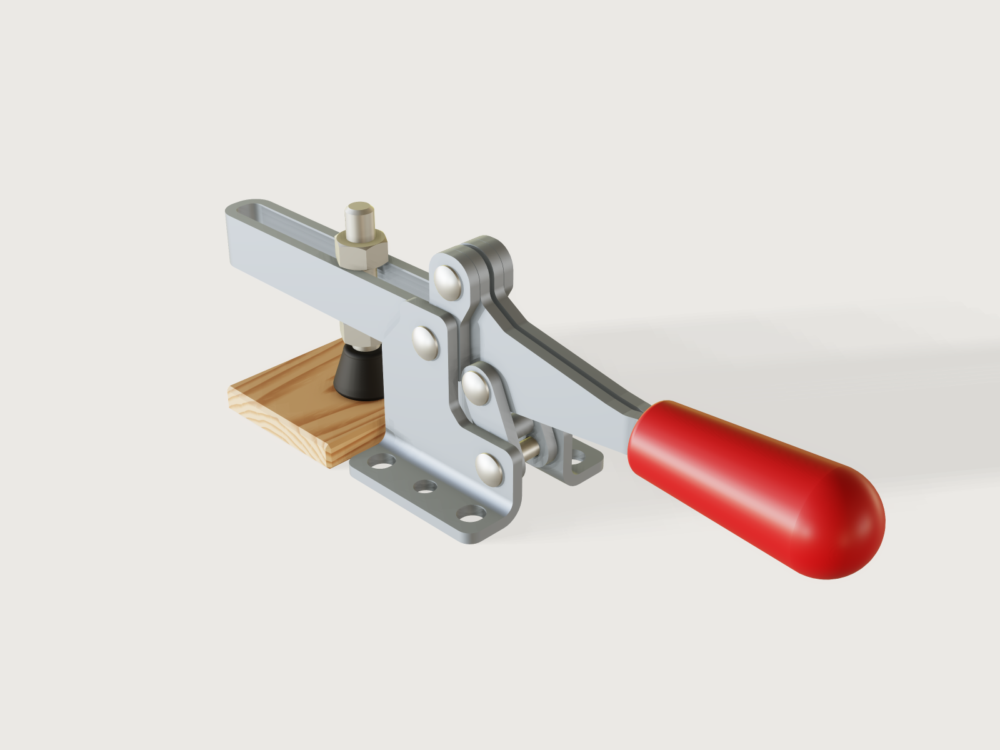
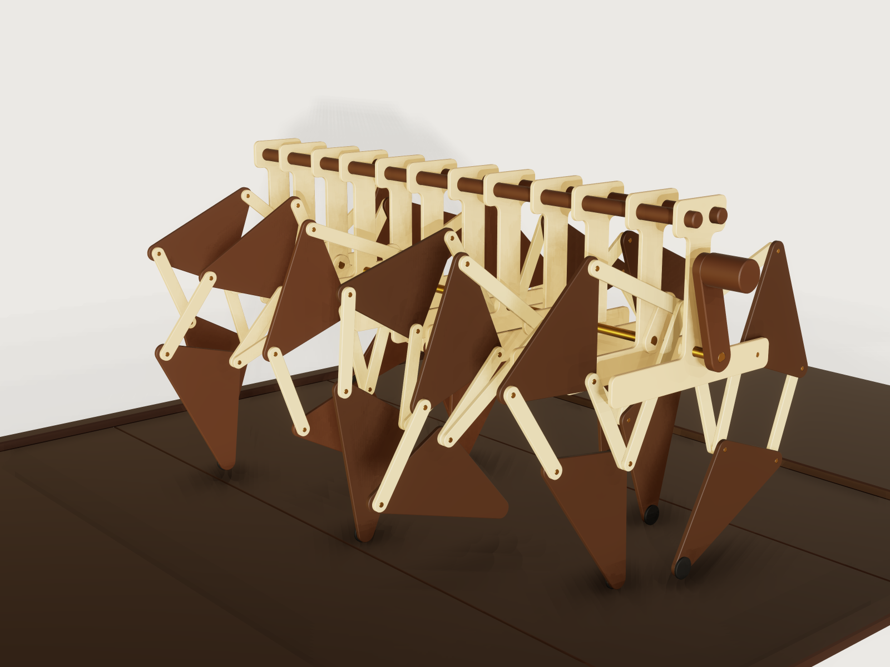
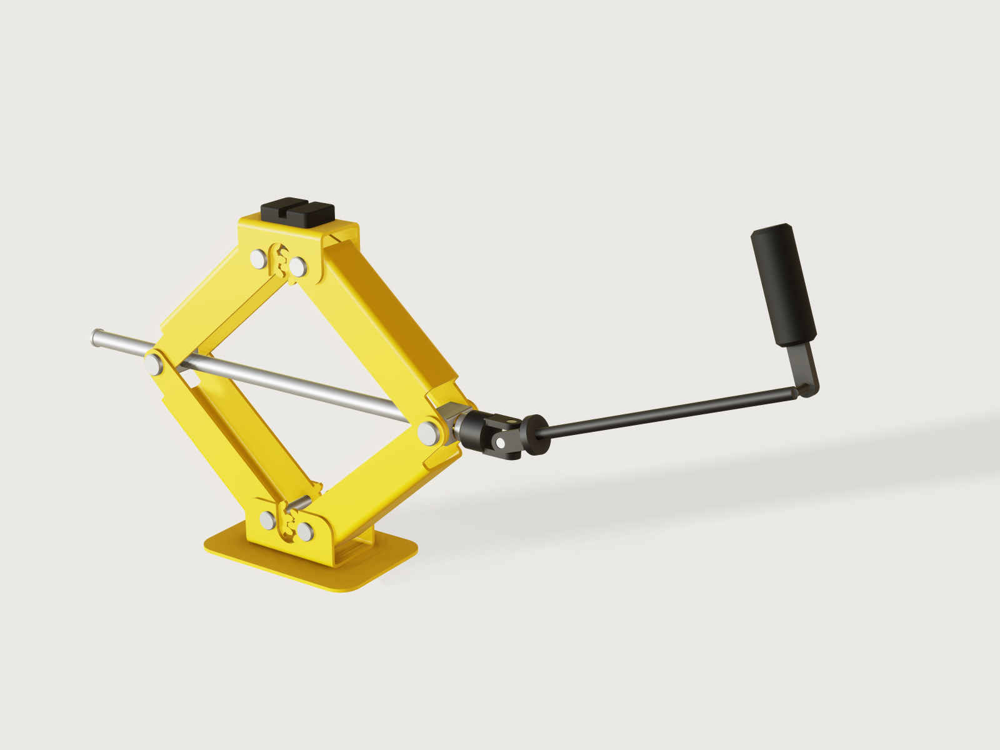
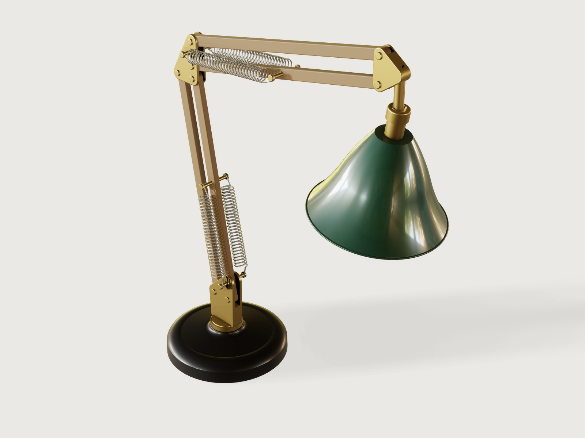
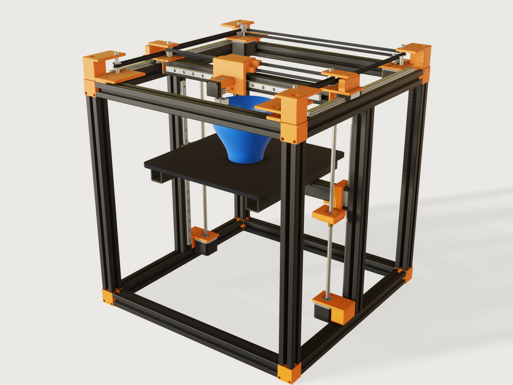
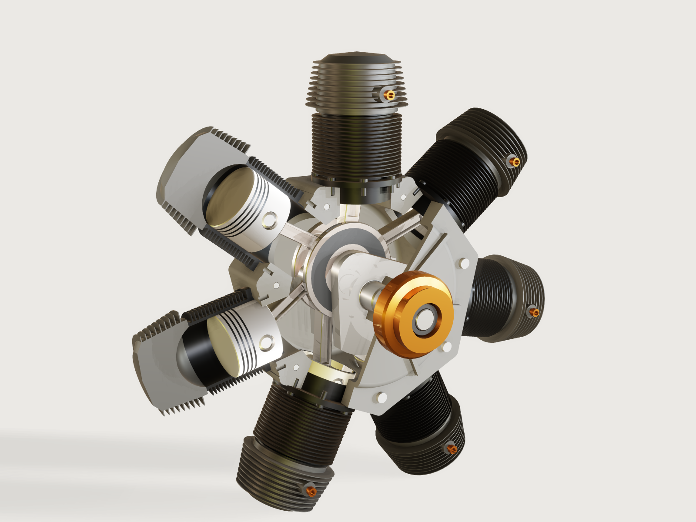

# 3DCraft assemblies

Six mechanisms built in [3DCraft](https://github.com/johancoppens/3dcraft), the open-source parametric CAD modeller
built for AI, from a simple clamp to a machine. Every one is real (sized to the standards of its trade), makeable (its
process checks are part of the model), proven (at rest and over its whole motion) and light (it opens in seconds).

Each assembly lives in its own numbered folder under [`assemblies/`](assemblies/), with:

- **`<id>.3dcraftasm`**: the assembly, with its parts packed inside; open it in 3DCraft and play its motion.
- **`parts/*.json` and `build.json`**: the 3DCraft commands that build it, ending with the checks that prove it.
- **`README.md`**: what it shows, the real thing behind it, how it goes together.
- **`prompt.md`**: a conversation you can have with an AI connected to 3DCraft to build it yourself.
- **`exports/`**: files for the workshop where they make sense.

To open them, install 3DCraft 0.1.0 or later from [3dcraft.dev](https://3dcraft.dev/) (the installers are also on
[its release page](https://github.com/johancoppens/3dcraft/releases)), or use no installer at all: the gallery at
[3dcraft.dev/examples](https://3dcraft.dev/examples/#assemblies) opens every assembly in 3DCraft's
[web version](https://3dcraft.dev/app/), in your browser, at
`https://3dcraft.dev/app/?open=/examples/assemblies/<id>.3dcraftasm`.

## Gallery

From simple to complex, each with the difficulty its reviewer scored out of 10. The reviewer was an AI agent in the
role of a professional of the assembly's trade (a toolmaker, an automotive engineer, a lighting designer, a machine
builder, an engine builder) and of the fitter who must put it together, working apart from the agent that built it;
every assembly passed that review, and its prompt was tested by a second AI model. [`AGENTS.md`](AGENTS.md) §8 names
the models and effort levels, and the briefs the assemblies were built from are in [`CATALOGUE.md`](CATALOGUE.md).

<!-- gallery:start -->
| | Assembly | Domain | Difficulty |
|---|---|---|---|
|  | **[Horizontal toggle clamp](assemblies/01-toggle-clamp/)**<br>A horizontal hold-down toggle clamp of the M6, 900 N class: a formed base in two mirrored L halves held by the pivot rivets, a formed U-bar with an M6 spindle and rubber cap, a stamped link and handle with a red PVC grip, all on rivet pivots. | Workshop, sheet metal | 5/10 |
|  | **[Jansen linkage walker](assemblies/02-jansen-walker/)**<br>A hand-cranked twelve-legged walking machine after Theo Jansen's linkage: laser-cut birch bars and frame ribs, walnut-faced plywood triangles, brass pins and a keyed brass crankshaft, walking on a floor of boards that rolls one board per turn. | Kinetic art, laser cutting | 8/10 |
|  | **[Scissor car jack](assemblies/03-scissor-jack/)**<br>A pressed-steel scissor jack sized after jacks sold as 1 t: four U-section arms with gear-tooth ends, a screw between a nut trunnion and a bearing trunnion, a saddle held level by the gears, and a tilted folding crank on a Hooke joint. | Automotive, sheet metal | 6/10 |
|  | **[Spring-balanced task lamp](assemblies/04-task-lamp/)**<br>A two-arm desk lamp in oak and brass on a cast-iron base, balanced by four real extension springs. The torque about each arm's pivot, from the measured masses and the real springs, stays within a stated pivot friction over a sweep of poses. | Product design, lighting | 6/10 |
|  | **[CoreXY 3D printer](assemblies/05-corexy-printer/)**<br>A desktop CoreXY FDM printer with a 250 mm build area: a black T-slot frame, MGN12 rails, NEMA 17 motors on two GT2 belts, a bed on two T8 lead screws with floating nuts, and a blue spiral vase printed as a time-lapse while the nozzle runs its rim. | 3D printing, machine building | 8/10 |
|  | **[Seven-cylinder radial engine with its valve train](assemblies/06-radial-engine/)**<br>The seven-cylinder radial with its valve train: a double-track cam ring turned at one sixth of the crank speed through reduction gears, roller tappets, pushrods, rockers and poppet valves in a cut-away crankcase and opened cylinders. | Aviation, engines | 8/10 |
<!-- gallery:end -->

## Rebuild and check

The committed `<id>.3dcraftasm` files and `exports/` are the finished assemblies: open one in 3DCraft 0.1.0 or later,
in the window, in the browser or with `craft3d-cli`, and play its motion, without rebuilding anything. Each carries its
parts.

**The command line.** Every installer of 3DCraft has `craft3d-cli`. The Linux tarball's `install.sh` puts it in
`~/.local/bin` and the Windows installer puts it on your `PATH`; on macOS and with the AppImage you reach it as
[the install chapter of 3DCraft's guide](https://3dcraft.dev/guide/0.1/install) says: on macOS a link to
`/Applications/3DCraft.app/Contents/MacOS/craft3d-cli` on your `PATH`, with the AppImage a link named `craft3d-cli`
that points at it. Instead of `PATH`, `CRAFT3D_CLI` may name the binary (or that link).

**The tool.** `tools/assemblies.py` (Python 3, standard library only) made and checked every assembly: it builds
every part, then the assembly, packs it and checks it at rest and over its motion. It runs on Linux and macOS, not on
Windows. It needs the 3DCraft build this repository is pinned to, as `craft3d-cli --version` reports it: the commit
in [`tools/pin.json`](tools/pin.json), or the release named there (0.1.0) with the file format named there (69), so
the installed 3DCraft 0.1.0 runs it. It refuses any other build, because it compares what it rebuilds byte for byte
with the committed files and another build may write other bytes. `--version` names the version, the commit and the
file format, and nothing in it tells the released 0.1.0 from a development build that still carries the same version
number: the tool accepts both, and with a build that is not the pinned commit, `check` may report files as stale that
differ only in their bytes.

To rebuild and check one assembly with the installed 3DCraft 0.1.0:

```sh
craft3d-cli --version                           # craft3d-cli 0.1.0 (<commit>, format 69)
tools/assemblies.py check --quick toggle-clamp  # rebuild in a scratch folder (.scratch/) and check at rest and over the motion
tools/assemblies.py check toggle-clamp          # the same, plus check-range and the motion at up to 8 corners of the ranges
tools/assemblies.py build toggle-clamp          # parts and build.json -> .3dcraftasm and exports; rewrites meta.json
tools/assemblies.py render toggle-clamp         # preview.png
```

`build` rewrites the assembly's `.3dcraftasm`, its exports, and the `stats` (timings measured on your machine) and
`craft3d` (the build that wrote them) fields of its `meta.json`; `check` without `--quick` writes only the slowest
point of the ranges into `stats` (`range_worst_s`); `git diff` shows what changed. Give `check` an id: without one it
rebuilds and checks all six, which takes hours. Where `systemd-run` exists, every run is capped in memory (in the
slice named by `CRAFT3D_SLICE`, default `assemblies.slice`), and on Linux the tool waits while less than 1.5 GB of
memory is free.

## Problems and feedback

A problem with an assembly (a wrong size, a check that fails, a part that cannot be put together, a page that says
what the model does not do): open an issue in
[this repository](https://github.com/johancoppens/3dcraft-assemblies-examples/issues). A problem with 3DCraft itself:
[3DCraft's issues](https://github.com/johancoppens/3dcraft/issues).

[`3DCRAFT-FEEDBACK.md`](3DCRAFT-FEEDBACK.md) is the dated record of what 3DCraft got wrong or could not yet do while
these assemblies were built, each bug with a reproducer under `findings/`; it is not a list of the known issues of a
release.

## Licence

The assemblies, their parts and what is written and drawn about them (the pages, previews, `AGENTS.md`,
`CATALOGUE.md`, the feedback) are under **CC BY 4.0** ([`LICENSE-CC-BY-4.0.md`](LICENSE-CC-BY-4.0.md)), as each
document's information says; the code, the tool under `tools/` and the reproducers under `findings/`, is MIT
([`LICENSE`](LICENSE)). One part is MIT too: the CoreXY printer's T-slot profile, copied from the
[3DCraft examples](https://github.com/johancoppens/3dcraft-examples). Every page and every `meta.json` states its
licence. Credit an assembly as:

> "Scissor car jack" by Johan Coppens, from the 3DCraft assemblies (CC BY 4.0),
> https://github.com/johancoppens/3dcraft-assemblies-examples

with its title. Sources from elsewhere, and the products parts are sized after: [`ATTRIBUTION.md`](ATTRIBUTION.md).

Agents and contributors: read [`AGENTS.md`](AGENTS.md) first.
