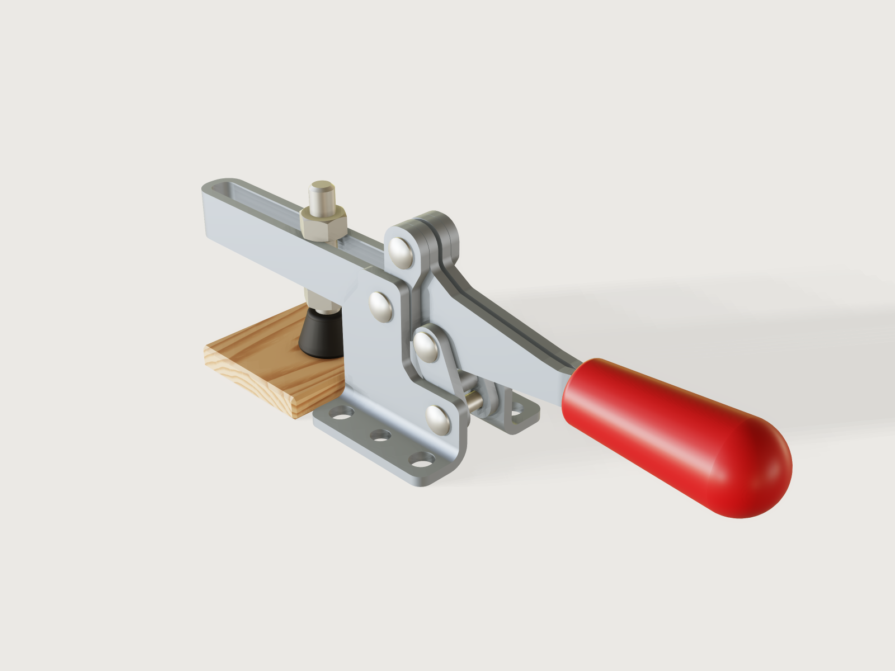

# Horizontal toggle clamp

A horizontal hold-down toggle clamp of the M6, 900 N class, modelled the way it is made: a formed, zinc-plated base in
two mirrored L halves held by the pivot rivets, a U-bar folded from one blank, a link of two stamped plates, a handle of two
stamped halves joggled together under a red PVC grip, an M6 spindle with a black rubber cap and two lock nuts, and four
rivet pivots. It is a real four-bar: `t` drives the link from open, through the toggle line, to a stop just past it,
and back; the over-centre position is proven by the knee's joint angle, and the mechanical advantage is a live output
of the solved model, checked against a closed form.



## What it shows

- **Sheet metal.** `feature.sheetMetal` makes each base half (a flange bent up into an ear, `outline` in the flat), the
  U-bar (a narrow web bent into two legs) and each handle half (a joggle, `jogs`, so the halves meet under the grip);
  `file.export` with `sheetMetal` writes each flat pattern as DXF. The link's plates are flat: `feature.sheetMetal` with no flanges, one plate of stock thickness mirrored to the other. One source, two instances, for the mirrored base halves
  (`params`, `hand`, and `feature.mirror` with `when`).
- **Own frames.** Every part is drawn with its own pivot at the origin; the assembly passes lengths and angles by
  `params`, so changing a link length or the over-centre angle rebuilds the whole mechanism.
- **One closed loop.** Four `mate.add` revolutes make the four-bar; `assembly.solve` reports 0 degrees of freedom; the
  only drive is `joint.set` on `Link_pivot`, a formula of `t`, with `limits` on that mate.
- **One pivot part, two configurations.** `rivet` is placed four times in two spans.
- **Outputs and assertions from the solved pose.** `variable.measure` of `position`, `jointAngle` and `boxMax`/`boxMin`,
  `variable.output` for the mechanical advantage, and an independent closed form of the same ratio from the drive alone.

## The real thing

**Reference.** Sizes follow the DESTACO 217-U (flanged base, U-bar), catalogue sheet *217 Series*, pages MC-HHD 9 and 10
(`shop.torvigo.es/area_descargas/DESTACO/2741.pdf`), read directly. The class was checked against the 215-U (890 N,
M6 or 1/4; *215 Series* sheet, `static.raptorsupplies.com/catalog/product/datasheet/destaco-215-uss.pdf`) and the 225-U
(2220 N, M8 or 5/16; *225 Series* spec sheet, `shop.torvigo.es/area_descargas/DESTACO/2742.pdf`). All three are read, not recalled.

| Catalogue value | | This model |
|---|---|---|
| Max. holding capacity | 900 N (200 lbf) | not proven: nothing here carries a load |
| Bar opening | 91° (+10°) | 90.99° at the default handle opening |
| Handle opening | 61° (+10°) | 41° default, range 30° to 42° (below) |
| Spindle | M6 or 1/4 | M6 |
| Overall length, closed | 167.2 mm | 167.2 mm (bar tip to grip end) |
| Height at the top of the toggle | 49.6 mm | 49.58 mm |
| Bar tip from the base's front | 58.4 mm | 58.4 mm |
| Base length × width | 37.0 × 39.8 mm | 37.0 × 39.8 mm |
| Mounting pattern | 26.2 × 28.4 mm | 26.2 × 28.4 mm |
| Mounting slots | about 5.5 × 8.5 mm (3.0 between arc centres, read off the drawing) | 5.5 × 6.0 mm (below) |
| Round holes | Ø4.8 | Ø4.8 |
| Height under the bar | 23.4 mm | 23.4 mm |
| Bar pivot behind the base's front | X = 13.5 mm | 13.5 mm |
| Exerting : applied force | 7:1 at X1 = 28.6 mm, 3:1 at X2 = 66.8 mm | 7.66:1 at `t = 30/72` (a comparison, below) |

The sheet does not list the pivot centres; they were read off its side view (A 13.7/32.8, B 20.9/44.2, C 25.6/25.8, D
31.3/11.6, ±0.5 mm, in x behind the base's front and z above the bench). The model's pivots are A 13.5/30.6, B
17.43/43.93, C 24.70/24.13, D 30.92/9.60, found by a search (scratch script, not in the repository) that keeps A's x at
the catalogue's 13.5 mm and the pivots within 3.5 mm of the drawing, puts the knee exactly 3° past the toggle line, and
maximises the handle's travel at a bar opening of 91°. The pivots read off the drawing themselves stop at about bar 78° and handle 52° (dead point at 76.3° of link rotation), so the read-off cannot deliver the catalogue's stroke either. Link lengths A→B 13.9, B→C 21.1, C→D 15.8 mm.

**The handle travel is 41°, not the catalogue's 61° (+10°).** In this linkage the bar and the handle (A, B and C) come
into line at about 89.1° of link rotation from the stop, which is the dead point: the bar opens fast there and the
handle gains more, but the model must stop short of it (it stops at 88.2° of link rotation at the default, 88.9° is the
hard limit on the mate). I found no set of pivots near the drawing that reaches both 91° and 61°. With 91° kept, the
handle's travel is 41° at the default, and the parameter stops at 42°. The README names the gap rather than bending
the bar opening to fit.

**The class.** The M6 sizes are 890 to 900 N (about 92 kgf); the brief's 100 to 200 kgf does not quite meet an M6
spindle. **Holding capacity is not proven here.** Nothing in this model carries a load; the rating is the
manufacturer's.

**Over-centre.** 3°, by judgement: a trade article (Firgelli Automations, *De-sta-co Toggle Clamp Mechanism*, worked
example) uses three degrees past centre and says "a stop limits further over-center travel". Secondary, the only source
I read for it.

**Mechanical advantage.** The output is a virtual-work ratio of the solved pose (below). At `t = 30/72` (knee 7.1°
short of the toggle line) it is 7.66:1; at the stop it is 21.03:1 at the 28.6 mm reach; the assertions pin the second
number, and an independently computed closed form of the drive, tightly over the whole motion. The catalogue's 7:1 and
3:1 are given without an angle (its MC-TEC-4 page was not found), so they are a comparison here, not a proof. The ratio
scales as 1/reach: at the sheet's X2 = 66.8 mm the stop value would be 9.0:1; the slot's closed end limits the reach to
66 mm here.

**Sheet metal.** Low-carbon steel, 2.5 mm: the sheet shows 2.5 mm at the base's flange, and this model uses that stock
for every formed part (the nearest listed stock from a US sheet supplier, 12 Ga., is 2.54 mm: `oshcut.com/materialdetails/steel-a1008-cr`).
Inner bend radius = the thickness (2.5 mm): "keep the bend radius greater than or equal to the material thickness",
*Sheet Metal DFM Design Guidelines* (`fiveflute.com/guide/sheet-metal-dfm-design-guidelines-for-formed-and-punched-parts`),
which also gives the hole rule and the relief rule used below. K-factor from DIN 6935's correction factor k = 0.65 + 0.5 lg(r/s),
K = k / 2 = 0.325 at r = s (as quoted on `madegooddesigns.com/tools/bend-allowance-calculator`, a secondary source; DIN 6935
itself was not available).

| Part | Process | Blank (flat) | Notes |
|---|---|---|---|
| `base` (2×) | Laser-cut L blank, one 90° bend on a press brake; on a V16 die and R2 punch; `bendable` only shows the punch's stroke is free of collisions (a part with one bend has nothing else for it to hit) | 37.0 × 46.90 mm | Two mirrored halves held by the pivot rivets A and D, the ears 11.6 mm apart inside. By a rule of thumb (our judgement, no source read) an air bend forms about V/6, so V16 gives about R2.7, close to the R2.5 drawn. |
| `bar` | Laser-cut blank, folded into a U | 164.77 × 26.18 mm | One blank: two legs and a narrow web (the bend's neutral width) at the tip. The slot is the gap between the legs, formed, not cut. Formed in a U-die in one stroke, as a press tool does; the press-brake check refuses it (below). |
| `handle` (2 halves, one part) | Laser-cut blank, two-bend joggle of 0.6 mm | 30.26 × 90.08 mm | Each half is a formed stamping; the two halves are joined face to face at the tang inside the grip by spot welds (not drawn). The joggle is formed in a press tool; `bendable` has no flange to check on it, so none is claimed. |
| `link` | Two flat stamped plates and a staked spacer | 23.53 × 15.22 mm (bounding box of the oblique capsule, 24.8 × 9.0 mm long by wide) | Flat `feature.sheetMetal` plates with no bends, stock thickness; the spacer is a separate staked pin in the real part, drawn as part of the link. |

Rivets, spindle, nuts, cap and grip are not sheet metal. The rivet shanks are Ø4 in Ø4.3 bores (0.15 mm radial, a stated
running fit, not a standard fit class); the rivets have domed heads. ISO 4032 M6 nuts (width across flats 10 mm, height
5.2 mm, read from *ISO 4032:1979* table, iTeh preview); the thread pitch is 3DCraft's ISO 261 table for M6, as
`feature.thread` reports it.

**Layers along y, from the centre outward:** the spindle slot (±3.2), the handle halves inside it behind the spindle
(0.6 to 3.1 each side, meeting at y = 0 under the grip), the bar's legs and the link's plates (3.2 to 5.7), the base's
ears (5.8 to 8.3). The bar and the link share a layer and clear each other in the plane; 0.1 mm of side clearance between
layers. Rivet heads clear the outer plate by 0.2 mm.

**Against the process rules, stated:**
- **Holes ≥ 2.5 t + r from a bend (8.75 mm here): not met in the base.** The catalogue's mounting pattern puts the slots
  against the ear (the slot's inner end is 0.40 mm from the bend's tangent line), and the D pivot bore is 2.45 mm above the
  bend's tangent line: moving D from the drawing's z 11.6 to 9.6 mm in the search costs those 2 mm. The DXF cuts all of
  them in the flat, and the distortion at that thin land by the bend is accepted; the bores are meant to be reamed
  in line across the two halves after forming. The U-bar's and the handle's holes meet the rule (asserted).
- **Reliefs:** every bend runs the full length of its edge, so no bend ends inside an edge and no relief is needed.
- **Inner radius R = t is a stated limit.** The sources read say at least the thickness; a smaller radius needs a
  source I did not find for this steel. With R = t the bend's tangent line is at y = 10.8 mm, 3.4 mm from the slot's
  centre, so a screw head or washer over Ø6.8 mm rides up the bend radius, and the slot is held to 5.5 × 6.0 mm (the
  sheet shows about 8.5) to stay on the flat.
- **Edges** are as-cut, the sheared edge of the blank (a tumbled part breaks them slightly; a 0.4 mm chamfer on a
  sheet part's rim would only hold while its outline's corner arcs stay exactly tangent, and these are tangent at the
  defaults, not at every point of the parts' ranges, so none is drawn on the sheet parts).

**Simplified or left out.** The rubber cap is not soft (passing the toggle line it pushes 0.045 mm into the workpiece,
the preload a real cap gives, and is listed as a contact). The bar's strength, the rivets' forming, the plating thickness
and the flanged washers are not modelled. The workpiece is a prop.

## Parts and assembly order

| Part | Count | What |
|---|---|---|
| `base` | 2 | Formed L halves, mirrored by `hand` (one source) |
| `bar` | 1 | Formed U-bar |
| `handle` | 1 | Two joggled halves and a PVC grip |
| `link` | 1 | Two flat plates and a spacer |
| `rivet` | 4 | Two spans (17.0 and 11.8 mm; 0.2 mm under each head) |
| `spindle` | 1 | M6 rod and rubber cap |
| `nut` | 2 | ISO 4032 M6 |
| `workpiece` | 1 | Beech block standing under the spindle |

To build it: spot weld the handle's halves at the tang and mould or dip the grip over them. Set the link's plates on
either side of the handle at the knee and rivet C. Pass the bar's legs between the ears and rivet A through ear, bar, bar
and ear; rivet B through the bar's legs and the handle's halves; rivet D through the two base halves and the link. Then
fit the spindle: thread the lower nut on the rod, pass the rod up through the slot from below, thread the upper nut on
from above, and set the height with the two nuts. The rod has to go in from below since the slot is 6.4 mm wide and the
nuts are 10 mm across flats.

## The motion

`t` plays one working cycle, not a repeat: open at `t = 0`, clamped at `t = 0.5`, open again at `t = 1`. The joint
`Link_pivot` is driven by `link_drive_angle = open_link_angle (1 + cos(360° t)) / 2`, from `open_link_angle` (at the
default handle opening) down to 0, the stop.

| `t` | Knee (past the toggle line) | Bar opening | Mechanical advantage |
|---|---|---|---|
| 0 (open) | −126.2° | 90.99° | 0.98 |
| 30/72 | −7.13° | 0.39° | 7.66 |
| 0.5 (stop) | +3.00° | 0° | 21.03 |

The bar's rotation has its extreme at the toggle line, a little past the clamped pose: the rubber cap goes 0.045 mm below
the block's top there, the preload, listed as a contact. The stored pose is `t = 0.5`, clamped. The motion is proven at
the samples of `motion.check` (73), not between them.

**Limits.** `Link_pivot` is limited to `0` (the stop) and 88.9°, just short of the point where the bar and the handle line
up (about 89.1° from the stop).

## Parameters

| Parameter | Range | Default | What it does |
|---|---|---|---|
| Workpiece height | 3 to 8 mm, step 0.5 | 6 mm | Sets the block and the spindle: the cap meets the block at the clamped pose |
| Handle opening at rest | 30° to 42°, step 1° | 41° | How far the handle has turned from clamped at `t = 0` and `t = 1`; the link's opening is the closed form that follows |
| Spindle reach | 28.6 to 66 mm, step 0.2 | 28.6 mm | From the bar pivot to the spindle along the slot; the catalogue's X1 is the default |

The workpiece height comes from the model's stack: the bar's underside at 23.4 mm (the sheet's), the rubber cap (10 mm)
and the lower nut (5.2 mm).

## Checks

**At the stored pose (clamped):**
- *Knee is past the toggle line at the clamped pose*: the joint `Knee` is 3° within 0.05°.
- *Rubber cap meets the workpiece at the clamped pose*: the measured top of the block against the measured bottom of the
  cap, within 0.02 mm.
- *Link rests on the bar's stop pad*: 0.02 to 0.12 mm between Bar and Link (0.05 mm by design).
- The ten *… has its running fit* clearances: at most 0.18 mm (the 0.15 mm radial clearance; an upper bound, so a
  loosened bore fails), and at least 0.02 mm (the lower bound is what the measure proves, below).
- *Advantage at the stop, independently computed*: the output × reach equals 601.57 mm within 0.3 mm (21.03 at 28.6 mm),
  a value computed outside the model by finite differences of the kinematics.

**Over the motion (`motion.check`, 73 samples, at the defaults and the corners):**
- *Spindle to grip ratio matches the closed form of the drive*: 1 / the output, against a closed form of the four-bar from
  the drive alone, within 0.001. This is the solved pose against the formula, independent of the solver's frames.
- *Bar and link clear each other over the motion* (at least 0.02 mm).
- *Bar opening matches the closed form at the open pose* and *Handle opening at the open pose is the parameter*, to 0.02°.
- *Knee is short of the toggle line while closing* (at `t = 30/72`) and *Bar opens wide enough to load a workpiece* (the
  spindle tip at least 30 mm above the block at `t = 0`).
- No collisions except the listed contacts.

The check over the public ranges (`tools/assemblies.py check`) covers these at the corners.

**Mutation tests in a scratch copy:** moving the bar's handle pivot 1 mm fails the knee (7.51° measured), the cap (−2.15 mm), the stop pad and both advantage checks; a Ø5.5 mm bore fails the fit assertions (0.75 mm measured against the 0.18 mm bound); a block 2 mm taller or 3 mm shorter fails the cap (+2 and −3 mm); the grip force point moved 20 mm fails both advantage checks (762.0 against 601.57 mm; 0.0375 against 0.0475); an over-centre angle of −1° fails the knee and the stop advantage; the stop pad moved 1 mm fails the stop clearance (1.05 mm).

**Not proven by the samples:** nothing between samples; the toggle crossing is shown by the sign change of the knee's
joint angle. The fit lower bound is 0.02 mm because the clearance measure's proven bound is weak on a pin in a bore
(`Platform notes`); the upper bound is what catches a loose fit. The holding capacity is not checked.

## Files

- `toggle-clamp.3dcraftasm`: the packed assembly (`tools/assemblies.py build`).
- `parts/*.json`, `build.json`: the sources; the base's halves are one source with a `hand` parameter.
- `meta.json`: title, tier, contacts, preview framing and the tool's numbers.
- `exports/toggle-clamp.step`: the assembly with its structure; `exports/base-half.dxf`, `exports/u-bar.dxf`,
  `exports/handle-half.dxf`, `exports/link-plate.dxf`: the flat patterns.
- `preview.png`: the picture (`look.rotation` 180).

## Rebuild

```sh
tools/assemblies.py build toggle-clamp
tools/assemblies.py render toggle-clamp
tools/assemblies.py check toggle-clamp
```

## Difficulty

5 out of 10 (reviewer): one closed four-bar, but four real sheet parts with a joggle, flat patterns, own-frame
configurations and an independent closed form over the motion.

## Platform notes

- There is no sketch corner fillet, so about 130 corner tangent factors in the outlines are literals (`-0.269584 * (corner)`), exact at the defaults only ([`findings/A-new-no-sketch-corner-fillet/`](../../findings/A-new-no-sketch-corner-fillet/)).
- The press-brake check `bendable` has no one-stroke U-forming of two parallel bends, so the U-bar's forming is not
  proven by it ([`findings/A-new-bendable-one-stroke-u/`](../../findings/A-new-bendable-one-stroke-u/)).
- The fit assertions' lower bound: the `clearance` measure's proven bound for a pin in a bore is well below the value it
  finds (reported as "not proven" against a tight lower bound), so the lower bound is set to what it proves.
- A multi-body instance is not a measure subject by its name ([`findings/A-010-multibody-instance-subject/`](../../findings/A-010-multibody-instance-subject/)).
- A public parameter with a `step` refuses a value computed by an assembly ([`findings/A-011-computed-param-off-step/`](../../findings/A-011-computed-param-off-step/)):
  the parts' pivot parameters are published without a step.
- Threads are cosmetic (`feature.thread`): the spindle and the nuts are drawn at the thread's major diameter and the tap
  drill, listed as contacts in `meta.json` ([F-014](https://github.com/johancoppens/3dcraft-examples/blob/main/3DCRAFT-FEEDBACK.md#f-014)).
