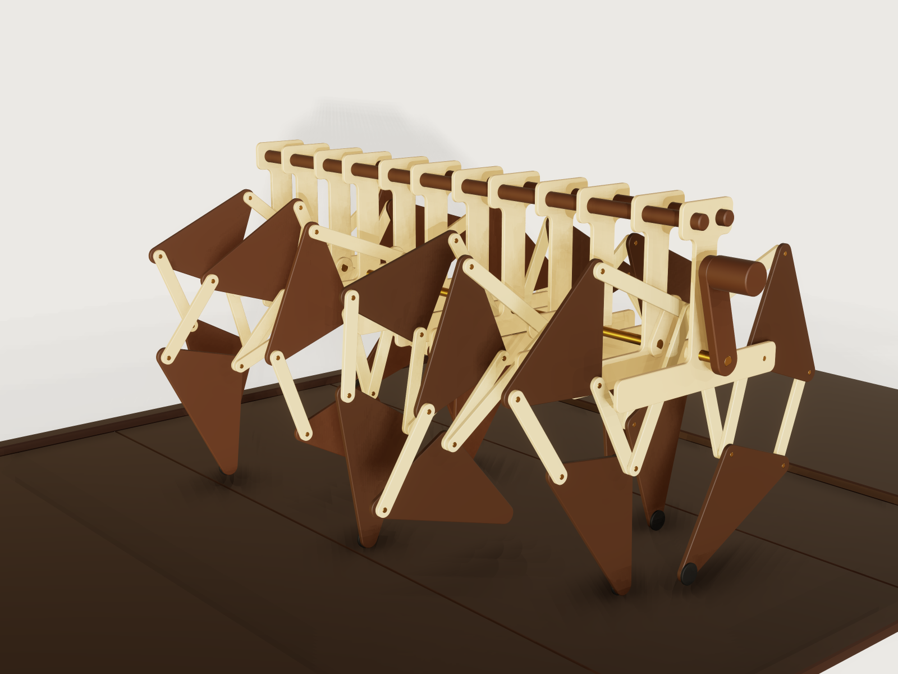

# Jansen linkage walker

A hand-cranked walking machine with twelve legs on one crankshaft, after the linkage Theo Jansen devised for his
*Strandbeesten*. Each leg is his thirteen published numbers in laser-cut 4 mm birch and walnut; six pairs of legs hang
from a row of frame ribs and are driven by a keyed brass crankshaft. One turn of the crank is one step of every leg, and
a floor of dark boards rolls back under the feet by exactly one board, so the motion loops without a jump.

## What it shows

- **Many closed loops in one solve.** 87 moving instances, 141 revolute, fixed and slider joints, and one crank drive (the floor has its own slide): `t` turns the
  crank (`joint.set` on the mate `Drive`) and everything else follows. `assembly.solve` reports 0 degrees of freedom.
- **A leg as a flexible subassembly** (`instance.add` with `"mode": "flexible"`), placed twelve times from one source,
  its scale and sheet sizes passed through `params`. The aft legs are the same subassembly turned half a turn about z.
- **One bar part in several configurations**: `bar` is placed 48 times in four lengths, its length coming through `params`
  (`bar_length`). Ribs, crank segments and the two triangles are configurations too.
- **Phase in the part.** Each journal rod is a configuration with its own `key_angle`: the turn between the flats at its two
  ends. Its far flat and the datum the next throw mates to are drawn at that angle, so a throw's phase is in the
  geometry of its rod and not in a mate value. See *Platform notes* for what was tried first.
- **Closed form against the solve**: `variable.measure` of a joint position (`position`), and the linkage's own circle
  intersections written as document variables, compared at every sample by `assert.add`.
- **Measured contact, balance and slip** as outputs (`variable.output`) of the measured feet and the measured centre of
  mass (`centerOfMass`, from the materials of `body.material`).
- **The foot's path as a trace** (`view.trace`, see *The motion*).

## The real thing

**The linkage.** Theo Jansen found the proportions of his leg by an evolutionary search and published them; the bars
are the numbers below, in his units, with `m` the crank and `(a, l)` the offset of the fixed pivot from the axle.

| a | b | c | d | e | f | g | h | i | j | k | l | m |
|---|---|---|---|---|---|---|---|---|---|---|---|---|
| 38.0 | 41.5 | 39.3 | 40.1 | 55.8 | 39.4 | 36.7 | 65.7 | 49.0 | 50.0 | 61.9 | 7.8 | 15.0 |

What was read: Wang (2026), Table 1 and equations 1 to 3 (the numbers and the joints as circle intersections); the
Wikipedia table *Jansen Linkage Ratios*; the OpenSCAD manual's Strandbeest example, whose code gives the numbers and a
fixed choice of each intersection. Jansen's own book and site were not read for the numbers (his site's front page
holds no text about them); that he published them is from those secondary sources. "Eleven holy numbers" is the
phrase Wang uses while listing thirteen values, `a` to `m`; Wikipedia does not use it, and what the eleven count is
not explained in the sources read.

**Which intersection.** Two circles meet twice, and thirteen numbers fit more than one leg. This model uses the
branches of the OpenSCAD example (mirrored, as its fixed pivot is on the other side), with joint C above the fixed pivot.
Own calculation, at 15 mm crank: this branch has a stride of 67.9 mm and 22.5 mm of lift, and its foot stays within 0.1 mm
of its lowest height for 98 degrees of the crank. The other branch for C has a stride of 82.9 mm and stays that flat
for far less of the turn; Wang's figures 1 and 2 show that other assembly (joint J2 below the pivot, foot x from about
-60 to +25). A flat stance is the whole point of the linkage, so the flat branch is the one built, and that choice is
this model's judgement, not a statement in Wang.

**Sheet parts, laser cut.** Bars, crank webs and frame ribs are 4 mm birch plywood. The two triangles are 4 mm
walnut-faced birch plywood, not solid walnut: at 131 mm spans with 3.9 mm of web beside the pin holes a solid 4 mm
walnut plate would split along the grain. Grain direction is free in the plywood; the walnut face runs along one side
of each triangle, as nested. The drawn holes and outlines are finished sizes: the laser's kerf is compensated by its
own offset (about 0.2 mm on a typical machine; not modelled). The smallest hole is the 4.2 mm pin hole in 4 mm sheet,
so no hole is smaller than the sheet, as the bar and the rib assert. Every sheet part has rounded corners and a 0.5 mm
chamfer (sanded after cutting).

**The key.** The phase of the crankshaft is in its geometry. Each crank web has a D-shaped journal bore, and each brass
journal rod has a flat at both ends (`rod_flat` 2.5 mm from the axis, a 1.5 mm deep flat filed or milled); the turn
between a rod's two flats is the phase between its two throws, and each rod carries its own turn (`key_angle`), one of -120
or 180 degrees here. The rod's flat lies 0.1 mm from the bore's flat, and the bore's round part 0.2 mm from the rod, so the flat is the tightest
fit; a wrong angle makes the rod overlap the
web, and eight clearance assertions see that at every sample. The hand crank is keyed to the last rod the same way, by a
D-bore in its arm.

**Turned and bought parts.** Pins are 4 mm brass rod in 4.2 mm holes (0.1 mm radial play, which the model checks at three
joints). Journal rods are 8 mm brass rod: they run in the 8.4 mm rib bearings with 0.2 mm of radial play and are
seated, keyed and glued, in the 8.4 mm D bores of the webs and the hand crank's arm: 0.2 mm radial play on the round part and
0.1 mm at the flat. Washers are M4 to DIN 125-1 A (4.3 x 9 x 0.8 mm, as listed by Fabory and Westfield
Fasteners). The crank-pin and hip spacers are brass tube of 7 mm outside diameter with a 4.3 mm bore, turned from 7 mm
rod (no stock tube of that size is claimed). The longerons are 12 mm walnut dowels, and the foot pads 18 mm rubber discs
glued to the tips. Masses come from assigned densities: birch and walnut-faced plywood 680, walnut dowels and knob 640,
brass 8440 and rubber 1100 kg/m³, typical values and this model's assumption; they matter only for the centre of mass.

**Sources read.** Jichao Wang, *Durability-Aware Multi-Objective Optimization of the Jansen Linkage*,
[arXiv:2606.22129](https://arxiv.org/abs/2606.22129) (2026), Table 1, eq. 1 to 3, figures 1 and 2, read in the PDF;
[Jansen's linkage](https://en.wikipedia.org/wiki/Jansen%27s_linkage), Wikipedia, the ratio table; [OpenSCAD User Manual,
Strandbeest example](https://en.wikibooks.org/wiki/OpenSCAD_User_Manual/Example/Strandbeest), the numbers and the code
of the joints. The washer sizes come from the listings of
[Fabory](https://www.fabory.com/en/plain-washer-din-125-1a-brass-m4/p/50060040001) and
[Westfield Fasteners](https://www.westfieldfasteners.co.uk/A2-Washer-M4.html), seen as search results; the standard
itself was not read. The linkage is Theo Jansen's; "Strandbeest" is his name for his works.

**Own judgement.** Module pitch, rib shape, bar width (12 mm), layer gap (1 mm) and the dark floor are design choices
checked by this model, not taken from a source. This is a kinetic model: no load, no drive torque and no strength of
the plywood are modelled or claimed.

## Parts and assembly order

| Part | Count | What it is |
|---|---|---|
| `bar` | 48, in 4 lengths | birch bar with a pin hole at each end |
| `hip-triangle` | 12 | walnut triangle (b, d, e) with its two pins and washers |
| `foot-triangle` | 12 | walnut triangle (g, h, i) with its two pins, three washers and rubber pad |
| `leg` | 12 | subassembly of 4 bars and the 2 triangles |
| `frame-rib` | 12 | birch rib: journal bearing, glued-in hip pin, spacer and washer |
| `crank-segment` | 6 | one throw: two webs with D-shaped journal bores, crank pin with spacers and washers |
| `journal-rod` | 7 | brass rod with a key flat at each end, the far one turned to the next throw's phase (the first rod's free-end flat is unused: one part for all seven) |
| `longeron` | 2 | walnut dowel along the top of the ribs |
| `hand-crank` | 1 | walnut arm with a D-shaped bore, and a knob |
| `floor-deck` | 1 | dark boards, one piece, rolling on a slider |
| `end-platform` | 4 | fixed dark platforms and side rails hiding the deck's ends and sides |

Layers, measured from the middle of a throw along the shaft (1 mm between layers, a washer in each gap between
moving bars; between a web and its rib there is 1 mm of bare clearance, no washer, and the shaft's end float lets birch touch birch
there, so wax those faces):

| From the throw's centre | What lies there | Pins through it |
|---|---|---|
| 0.5 to 4.5 mm | bar k | crank pin, knee pin |
| 5.5 to 9.5 mm | bars j, c, f | crank pin, knee pin, the pins C, D, F, hip pin |
| 10.5 to 14.5 mm | hip triangle, foot triangle | knee, C, D, F and hip pins; a spacer on the crank pin |
| 15.5 to 19.5 mm | crank web | crank pin, journal, hip pin spacer |
| 20.5 to 24.5 mm | frame rib | journal bearing, hip pin glued in |

Three layers are enough because only bars j and k ever pass over the shaft, so they run between the webs, where the
shaft is interrupted, and the journals start at the webs. Parts sharing a layer stay at least 11 mm apart over the turn
at the default scale (own calculation at every 2 degrees of crank, confirmed by the collision check below).

**To build it.** The crankshaft is strung up first, the frame is closed round it, the legs go in, and the crank pins
go in last. (Each pin points towards the middle of its throw, so a layer goes on by sliding it outwards.)

1. Cut the sheet parts and sand the chamfers. Cut the seven journal rods and file a flat on each end (the far flat is
   turned from the near flat by the rod's `key_angle`; a paper index glued round the rod sets it). Turn the spacers.
2. Glue a hip pin into each rib and the pins C, D, E and F into the triangles.
3. For each of the five inner rods, thread two ribs on its round middle (one rib's hip pin pointing to each end) and
   press a crank web onto each flat, flat into the D bore, until the shoulder of the rod meets the web; glue the webs to
   the rod. That makes five rod units; the two end rods make shorter units with one web and one rib each. Each rib turns
   freely on its rod.
   Hold each rod's flat against its bore's flat while the glue sets: the round part of the bore has 0.2 mm of play.
4. Lay the seven units in a line and pass the two walnut dowels through the top holes of all twelve ribs. Set the
   31 mm between the webs of each throw with a spacer, and glue the ribs to the dowels.
5. Build the legs from each rib towards the middle of the throw: on the hip pin a spacer, the hip triangle, a washer and
   bar c, whose far hole goes on the foot triangle's knee pin (a washer first); bar f on the pins D and F; bar j on
   pin C; bar k on the knee pin. The crank ends of j and k hang free.
6. For each throw, turn it so that the crank pin's place lies clear of the rib (the rib's stem and beam cover only
   part of the turn). Line up the holes of the two webs, j and k, and slide a crank pin in from the gap outside one
   web: web, spacer, j, washer, k, the centre washer, then the other leg's k, washer, j, spacer and web. Glue it in the
   webs only.
7. Fit the hand crank's D bore onto the last rod's flat and glue it.
8. Secure the free ends of the triangle pins with a drop of adhesive on a washer or a light peen (this retention is
   not modelled). Wax the faces of the webs and ribs, which may touch in the shaft's 1 mm of end float.

## The motion

The timeline `t` is one crank turn: the drive joint is `-(crank_start + 360 deg * t)`. Everything else follows through the
mates. The whole machine stands still; the floor deck slides along x by `floor_board * t`, in the direction a foot in
stance moves, so that the feet stand on it. That slide is exactly one board per turn, and the board seams are one board
apart, so the deck looks the same at `t = 1` as at `t = 0`; the fixed platforms cover both ends of the deck, so no edge
jumps either. The phases of the six throws are 0, 120, 240, 60, 180 and 300 degrees along the shaft (the order that
keeps at least four feet on the floor with the centre of mass inside them). There are no free motions.

**To see the path of a foot**: `view.trace {"point": "Fore[1]/Foot/Foot tip", "samples": 121, "grow": true}` (a trace is
view state and is not saved in the file, A-005).

## Parameters

| Parameter | Default | Range | What it changes |
|---|---|---|---|
| Scale of the leg | 2 mm per Jansen unit | 1.6 to 2.4 mm, step 0.1 mm | every bar, the rib, the crank radius, the floor, the stride |
| Crank start angle | 0° | -120 to 120°, step 60° | which throw starts where. The throws are 60° apart, so each step only renumbers them: the pose looks almost the same |

## Checks

**At rest**: `document.check` is ok; `assembly.solve` is ok with 0 degrees of freedom.

**Over the motion** (`motion.check`, `tools/assemblies.py check`), at the defaults and at the corners of the ranges, at 73
samples of `t` (every 5 degrees of crank). It holds at the samples; what happens between them is not checked by these
assertions.

| Assertion | What is compared | At the 73 samples (default size) |
|---|---|---|
| Fore 1 foot follows the circle intersections, x and z | the solved foot against the five circle intersections written as variables, within 0.01 mm | passed |
| Fore 1 foot stays inside the closed-form stride and lift; the stride and lift reach their ends | the foot against the closed form's extremes (-143.04 and -7.23 mm in x, top -138.75 mm in z); within half a sample of the extreme crank angle it is within 0.15 × scale of it | passed |
| Every foot stays inside the closed-form gait | all 12 feet inside the closed-form box of x and z at every sample: over a whole turn only Jansen's branch stays inside it, so this is what shows a leg off the branch | 12 of 12 |
| Enough feet stand on the floor | feet within 0.375 × scale (0.75 mm) of their lowest height; at least 4 | 4 at every sample |
| Pad comes down to the deck | the measured clearance from the foot pad to the deck, 0.05 to 0.3 mm, when the foot is at its lowest (Fore 1 and Aft 1; 0.3 allows a board seam under the pad) | passed |
| Feet slip at most the bound | a foot's distance from the floor point under it at mid-stance, while on the floor; at most 1.9 × scale (3.8 mm) | worst 2.81 mm |
| Centre of mass has a floor foot in every quadrant | a foot on the floor in each quadrant round the measured centre of mass, 10 mm clear of it in x and y (a sufficient test for being inside the feet); feet taken at the pad centres | passed |
| No foot goes below the floor level | the lowest foot against the closed form's lowest height | 0.0002 to 0.15 mm above it, never below |
| Throw 1 to 6 at 0, 120, 240, 60, 180, 300 degrees, x and z | each solved crank pin against the literal phase (not the variable that sets the key), within 0.01 mm | passed |
| The deck rolls forward one board per turn | the deck's solved position against `floor_board * t` | 280 mm at `t = 1` |
| Journals sit keyed; the hand crank is keyed | the least clearance from each rod to its web's or arm's D bore, 0.05 to 0.15 mm. The bore's round part is 0.2 mm off, so this least clearance is the flat's 0.1 mm; a wrong angle overlaps | 0.100 mm |
| The knee, crank and hip pins run with their stated play | clearance between pin and bore, 0.005 to 0.12 mm (nominal 0.1 mm radial) | 0.09999 to 0.1000 mm |

A pin that fits too loosely (a 4.3 mm hole, 0.15 mm radial) can come back as `notProven` from `motion.check` rather than failed,
because the clearance on near-coaxial bodies is proven only coarsely; a key flat too far from its bore (2.8 mm) comes back the same
way. `tools/assemblies.py check` counts both as a failure.

Measured over the turn at the default size, by `motion.check` and `view.trace`: the foot's path is closed, 297.9 mm long
(121 samples), with a stride of 135.8 mm and a lift of 44.9 mm (Jansen's numbers at crank 15 give 67.9 and 22.5, twice
that here at scale 2). The machine's mass is 1.25 kg, the output `machine_mass` (measured over every body but the floor, from the stated densities); its centre of mass stays within 0.82 mm of the shaft in x and at y = 5.9 mm (the hand crank sits at one end). The fine-grained maximum of the slip is 3.64 mm (closed form, every eighth of a degree, own
calculation), inside the 3.8 mm bound. The assertions hold at the corners of the public ranges too, and `check-range`
passes for the assembly and for every part that has public sizes.

**Collisions**: `tools/assemblies.py check` asks for named collisions at 121 moments of the turn over the whole assembly
(no pair may collide but the listed contacts, and none is listed). Nothing touches: the pins sit in their holes
with their radial play, the feet come down to 0.1 mm above the deck.

**What the samples do not cover**: the crank angles between samples; no strength, friction, torque or power is
modelled. The stance is a rigid-model statement: a foot counts as on the floor when it is within 0.375 × the scale
(0.75 mm at the default) of its lowest height, because a rigid plywood walker cannot put all its feet on one plane at
once.

## Files

- `build.json`: the assembly (variables, instances, mates, outputs and assertions).
- `parts/*.json`: the source of every part and of the leg (`leg.json`).
- `meta.json`, `prompt.md`, `preview.png`.
- `exports/jansen-walker.step`: the assembly with its structure.
- `exports/*.dxf`: the laser outlines at the default scale: four bars, both triangles, the rib and the crank web.
- `jansen-walker.3dcraftasm`: the packed assembly.

## Rebuild

`tools/assemblies.py build jansen-walker`, `tools/assemblies.py render jansen-walker`,
`tools/assemblies.py check jansen-walker`. No `gen.py` is committed: `build.json` and the part sources stand alone.

## Difficulty

8 out of 10 (reviewer): many coupled closed loops, flexible subassemblies, geometry-keyed configurations and a solver
branch limit to navigate.

## Platform notes

- **Phase through `params` was proven and not used.** A leg as a flexible subassembly with its own crank and
  `"params": {"t": "t + phase"}` plays correctly (the feet match the closed form at their phases), but every moment
  becomes a new configuration of the subassembly, and by 3DCraft's own rule the leg keeps its drive in the parent, so one
  real crankshaft would add a second driver per leg (that combination was not tried; reproducer
  `findings/A-012-params-t-rebuilds-subassembly/`). The legs
  are therefore flexible and undriven, and the phase lives in the key flats of the journal rods.
- **The solve cost grows with the mates on one body** (reproducer `findings/A-013-solver-hub-cost/`): one chassis
  carrying all 24 hip pivots took about twice as long as a rib per leg, so each leg has its own rib, grounded
  separately.
- [A-015](../../3DCRAFT-FEEDBACK.md#a-015): a solid texture does not turn with an instance's placement, so every wooden part is a
  plain colour (no grain pattern): grain on moving or turned parts would not follow them.
- **One stored pose, many solves.** A leg's stored poses are one set, whatever its throw's phase, and the rest solve is a single
  Newton solve from them. Away from the published values a leg can land on another branch: at a crank start of 180 degrees
  two legs do, and earlier scans at other angles showed the same. The published crank start is therefore limited to -120 to 120
  degrees in steps of 60; all 45 combinations with the scale were scanned leg by leg against the closed form (540 solves,
  none off the branch; 300 of them again on the final file) and the gait box checks it over the motion. The limit is really on the rest pose, the crank start plus the stored `t`: storing `t = 0`
  at the default start goes off the branch too, the same total angle the published range excludes. See
  `findings/A-016-rest-solve-branch-jump/`.
- [A-002](../../3DCRAFT-FEEDBACK.md#a-002): no pattern of instances, so `build.json` repeats six modules by hand; with
  the parts it comes to 775 steps, against the guide of 600.
- [A-005](../../3DCRAFT-FEEDBACK.md#a-005): the foot's trace is not saved in the file; the command to draw it is under
  *The motion*.
- [A-006](../../3DCRAFT-FEEDBACK.md#a-006): a part's own assertions are not checked per configuration; every part's
  `check-range` covers the values the assembly passes.
- [A-007](../../3DCRAFT-FEEDBACK.md#a-007) and [A-010](../../3DCRAFT-FEEDBACK.md#a-010): a multi-body instance is not a
  measure subject, so the centre of mass is taken over a name query and the clearances name single bodies.
- [A-011](../../3DCRAFT-FEEDBACK.md#a-011): the parts publish their sizes without a step, since the assembly passes them
  from formulas.

## Licence

[CC BY 4.0](../../LICENSE-CC-BY-4.0.md); credit line in the [README](../../README.md#licence).
