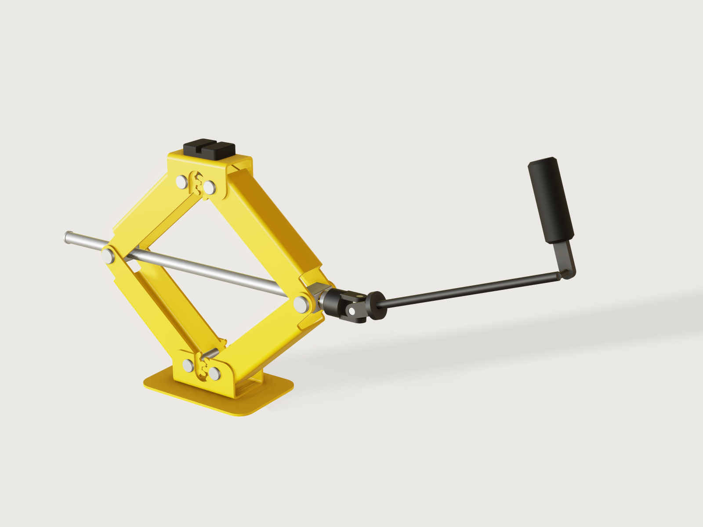

# Scissor car jack

A compact pressed-steel scissor jack sized after jacks sold as 1 t, the kind carried in a car: a base, four U-section arms with
gear-tooth ends, a nut trunnion and a bearing trunnion, a lead screw with a thrust collar, a saddle with a rubber pad
and a folding crank held at a tilt on a Hooke joint. It is one closed mechanism: as `t` plays, the screw turns, the nut
trunnion walks along the thread, the rhombus of arms rises and the gears at both ends keep the saddle level. Every
motion comes from mates and couplings; nothing is placed by formulas of `t`.

**This is a model, not a certified jack.** Nothing in it carries a load, and nothing in this README is a statement that
a jack built from it may hold a car. A jack holds a load over a person: whoever builds one must have its strength, its
overload and its manual forces verified against EN 1494 by someone qualified to do so (below).



## What it shows

- **A screw coupling and gear couplings inside one closed solve.** Eight revolutes close the rhombus (`mate.add`), a
  revolute and a cylindrical mate carry the screw between the trunnions, `coupling.add` ties the screw's turn to the
  nut's travel (kind `screw`) and each gear pair's two pivots (kind `gear`). `assembly.solve` leaves 0 degrees of
  freedom; the only driver is the screw's angle (`joint.set`, a formula of `t`).
- **A Hooke joint as a closed spherical loop.** The drive yoke on the screw's hexagon, the cross, and the rod are three
  revolutes (`mate.add`), closed by a fourth that holds the rod's axis at a tilt on the bearing trunnion: the solver
  finds the rod's angle. Its closed form is an assertion (*Hooke joint follows its closed form*, 1.6e-9 at most).
- **Teeth as geometry and as a ratio.** The gear sectors are drawn as involute teeth in the arms' flange outlines
  (`sketch.pattern` with a chain and an angle), and a gear coupling only knows the ratio: that they mesh in every pose
  is a measured clearance (`clearance` between the two arms of a pair, over the motion, with an upper bound).
- **Pressed sheet metal with its flat patterns.** Arms, base channel and saddle frame are `feature.sheetMetal`: a web
  and two flanges drawn as outlines, with the tooth profile and the bend reliefs in the flange's own flat, and bend,
  hole-to-bend and flat pattern checks. A DXF of every configuration's flat pattern is in `exports/`.
- **One arm part, four configurations.** Lower and upper arms differ in width; each pair is a left and a right hand
  whose teeth stand half a pitch apart so that a tooth meets a gap (the `tooth_hand` parameter). Mirroring by placement
  (`rotation`) does the rest: two arms that are plain mirror images cannot mesh, because a mirrored tooth lands on a
  mirrored tooth.
- **An output that follows the motion.** `variable.measure` of a joint angle gives `arm_elevation`; `variable.output`
  turns it into the screw tension, the root stresses, the torques and the hand force over the stroke.
- **One pivot part in configurations by `params`.** `rivet` is placed four times in two spans; `trunnion` twice, as a
  nut and as a bearing, by its bore.

## The real thing

**References read.**

| Source | What was read | Used for |
|---|---|---|
| Draper 69252 data sheet (`drapertools.com` product data PDF, created 21/07/26): *Scissor Jack, 1.5 Tonne* | Capacity 1.5 t; lifting range 230–390 mm; saddle size 50 x 36 mm; handle length 390 mm; base size 166 x 118 mm; weight 3.2 kg; "Manufactured to EN1494 Specification" | Saddle pad (50 x 36 mm), foot size class, crank length class |
| Draper 69251 product page (`drapertools.com/product/69251/scissor-jack-1-tonne/`) | 1 tonne; lifting range 200–370 mm; "Manufactured to EN1494 Specification" | The load class and the range class |
| Eufab 21032 instruction manual (`manualslib.fr/manual/150063/Eufab-21032.html?page=7`, the French section's page 7) | Maximum load capacity ("Capacité de charge maximale") 1.5 t; minimum lifting height 104 mm; maximum 380 mm; dimensions 430 x 100 x 100 mm; net weight 2.4 kg, all marked approximate | Folded length class (430 mm), lowest and highest height class |
| Dhamak, Bajaj, Aher, *Design and Optimization of Scissor Jack*, IJAPME vol. 2 issue 1 (2016), pp. 29–34 (`troindia.in/journal/ijapme/vol2iss1/29-34.pdf`) | Link length 200 mm; heights 254 to 355.4 mm; load 700 kg; "maximum load on screw will occur when the jack is at bottom most position. The load in the screw will be tensile"; screw 30C8 with Syt 400 MPa and a factor of safety 4 (100 MPa allowable in tension); the tooth profile on the link ends acts as a gear; failure photographs of tooth wear | The load path, the bottom position as the worst case for the screw, the form of the arm, the stress comparison below |

**EN 1494.** I could read only its scope and structure (the BSI listing for BS EN 1494:2000+A1:2008, the GSO and Genorma
catalogue entries): mobile or movable jacks operated under load, working under a raised load not permitted, with sections on
safety requirements, verification and test procedures; BSI's contents also name "Manual forces and manual force measurement
methods". **I could not read a requirement, a force or a test value from it**, and neither the Draper data sheets nor the
manual state one. The model claims no compliance with EN 1494; its requirements, its overload test and its limits on manual
force stay open, and must be verified against the standard by whoever builds a jack from this.

**The class.** This model is sized after jacks sold as 1 t, which is not a rating of the model: the Draper 69251 page gives 1 t and a range of 200–370 mm; the Eufab manual's jack folds
to about 430 mm long. This model's own numbers come out of its geometry: arms 165 mm pivot to pivot with the arm's slope going
from 8.7° to 68°, a saddle height of 121.9 mm lowest and 378.0 mm highest, and, folded and without its crank, about
440 mm from the screw's tail to the end of the drive yoke. The arm length, the gear pitch radius, the pad and the foot (160 x 108 mm,
the Draper's 166 x 118 mm class) are my reading of those references. The screw is 14 mm with a 3 mm lead (root diameter taken
as 11 mm); I found no source for a jack's screw thread, so this is a judgement, and the thread is cosmetic in the model.

**Materials and processes (judgement, except where a source is named).**

| Part | Process | Material and finish |
|---|---|---|
| `arm` (4 configurations) | Blanked and pressed in a U-die: 3 mm sheet, inner bend radius 3 mm; involute gear sector in both flanges; bend reliefs | Cold-rolled low-carbon steel, safety-yellow powder coat |
| `base` | Pressed U-channel, fillet-welded along both outer bend roots to a laser-cut foot plate | The same steel, safety-yellow |
| `saddle` | Pressed inverted U; moulded rubber pad with a groove for a car's pinch weld | Steel, safety-yellow; black rubber |
| `trunnion` (2) | Square block, cross-bored; one tapped (the nut), one plain (the bearing); flat-bottomed blind holes for the pins | Steel, bright zinc plated |
| `trunnion-pin` (4), `rivet` (4) | Turned and formed | Steel, zinc plated |
| `screw` | Turned and thread-rolled, with a collar and a hexagon drive; the tail is peened after the nut is on | Steel, zinc plated |
| `thrust-washer` | Turned or stamped | Brass |
| `crank` (5 instances) | Socket yoke, cross and rod yoke (a Hooke joint), a formed rod, a flat folding handle, a rubber grip | Black painted steel; zinc-plated cross; rubber |

The bend allowance uses the correction factor k = 0.65 + 0.5 lg(r/s), K = k/2 (= 0.325 at r = s), as the DIN 6935 form used
in `3dcraft-examples/examples/06-steel-bookend`; I did not read DIN 6935 itself. Inner bend radius equal to the sheet is the same
judgement as the toggle clamp's (no source read here). All sheet parts keep 2.5 t + r between holes and bend lines (asserted).

**Bend reliefs.** Each arm's flange runs on past the web at both ends, towards the gear and towards the trunnion. At those
four points per arm the flange's edge steps back 4 mm beyond the bend's tangent line, with a 1.5 mm radius in the corner, so
that no concave corner stands at the bend's end, where a 3 mm sheet would tear. The base and the saddle have no such corner:
their walls end flush with the web. They are in the flat patterns.

**Welding the base.** The channel sits flat on the foot plate and is held by two continuous fillet welds along the outer bend
roots of its two long sides, in the open, reachable from outside; no joint preparation is needed for a lap fillet on 3 mm
sheet. Drawn as one fused body, the welds not modelled.

**Gear teeth.** An equivalent full gear of 10 teeth, pitch radius 20 mm (module 4 mm), 25° pressure angle, stub addendum
0.8 m, dedendum 1.0 m, 0.4 mm backlash on the pitch circle, a 0.3 mm root fillet (a blanking die's corner; 0.25, 0.4 and 0.5 mm fail in the kernel, [A-019](../../3DCRAFT-FEEDBACK.md#a-019)), involute flanks **drawn as four chords on the
true curve** (see *Platform notes*: a formula-curve flank costs 13 times the regeneration of chords, four arm configurations
would break the budget). The contact ratio of this tooth form is 1.06 (my own closed form from those numbers, not the model's). Each gear has three or four teeth (the two hands of a pair stand half a pitch apart, so they mesh): enough to stay engaged over the 59° of travel; the mesh is proven by measure, not by stating the ratio (*Checks*).

**Fits.** Pivot rivets Ø10 in Ø10.4 holes; trunnion pins Ø12 in Ø12.4 arm holes; 0.75 mm side clearance between lower and upper arm flanges, 0.8 mm inside the base and saddle walls; the trunnion body 33 mm long between the upper arms' flanges 34 mm apart; heads of rivets and pins 0.3 mm off the walls they hold. These are stated clearances, not standard fit classes; the pin-hole and bore fits are asserted two-sided (*Checks*). The screw's shank Ø14 turns in a Ø14.4 bearing bore and the thrust collar stands 0.1 mm off a 2 mm brass washer (Ø21.5, inside the 22 mm block face). The nut's bore is drawn at the tap drill (the thread is the joint, listed in `contacts`). The trunnion pins are pressed 6 mm into flat-bottomed blind holes in the trunnion, a floor 3.3 mm from the bearing bore and 3.5 mm from the thread's major; the thinnest wall of the block is at the bearing bore's mouth, 2.3 mm between the Ø14.4 bore and the block's R1.5 corner (`measure.thickness`, asserted at least 1.9 mm over the part's range). The pins are drawn line-on-line across the bore and listed as contacts; the rubber pad is bonded to the saddle (listed).

**Forces (from the model, for the saddle load of 1000 kg; assumptions below).** `screw_force = W / tan(arm_elevation)` from
the joint angle the solver computed; the root stresses from the thread's root diameter; the torque from the thread and the
collar.

| `t` | Saddle height | Arm angle | Screw tension | Root tension | Root torsion | Von Mises | Crank torque to raise | Hand force at 110 mm | Torque to lower |
|---|---|---|---|---|---|---|---|---|---|
| 0 | 121.9 mm | 8.70° | 64.09 kN | 674 MPa | 351 MPa | 908 MPa | 178 N·m | 1623 N | 29.1 N·m |
| 0.1 | 237.2 mm | 30.0° | 16.96 kN | 178 MPa | 93 MPa | 240 MPa | 47.2 N·m | 429 N | 7.7 N·m |
| 0.2 | 292.9 mm | 42.0° | 10.88 kN | 115 MPa | 60 MPa | 154 MPa | 30.3 N·m | 276 N | 5.0 N·m |
| 0.3 | 330.9 mm | 51.7° | 7.75 kN | 82 MPa | 42 MPa | 110 MPa | 21.6 N·m | 196 N | 3.5 N·m |
| 0.4 | 358.3 mm | 60.2° | 5.62 kN | 59 MPa | 31 MPa | 80 MPa | 15.7 N·m | 142 N | 2.6 N·m |
| 0.5 | 378.0 mm | 68.0° | 3.96 kN | 42 MPa | 22 MPa | 56 MPa | 11.0 N·m | 100 N | 1.8 N·m |

The paper above says the screw is worst at the bottom position, and the model agrees: the tension is highest low down
and falls with the height. Read those numbers as outputs of a screw model, not as a rating. **I state only this:** the root
tension stress alone reaches an assumed 200 MPa (`height_tension_at_two`, an assumed yield of 400 MPa, half of it, a judgement) at
a saddle height of 223.3 mm; with the factor of 4 the paper uses (100 MPa allowable tension, `height_tension_at_four`), at
309.0 mm. That is the tension only: the thread torque adds torsion, and the von Mises stress at 223 mm is about 269 MPa
(by the same formulas as the table: a factor of 1.49 on the assumed yield, not 2). **None of
this is a statement of where the jack may lift a car.** The arms, the pins, the bearing pressure and the thread shear are not computed at
all; the 1000 kg is an input to the arithmetic, not a capacity. The hand force is what a person would need to wind it: 429 N at
`t = 0.1`, 276 N at `t = 0.2`, over 67 turns; that is the kind of force EN 1494's manual-force section governs, which I
could not read.

**Assumptions in those numbers:** the thread friction coefficient μ = 0.15 (not sourced), the torque formula T = F · (d_m/2 · tan(λ + φ) + μ_c · R_c) for a square-profile screw (the trapezoidal thread's flank angle is ignored), the thrust collar friction 0.15 on a 9.0 mm mean radius, load shared equally by the symmetry the gears hold, an assumed screw steel of 400 MPa yield, and no bending or friction elsewhere.

**Self-locking.** Lead angle 4.37° (3 mm lead, 12.5 mm mean diameter). The model holds the screw to the worst friction it
assumes for self-locking, μ = 0.10 (friction angle 5.71°), and caps the public lead at 3.5 mm (5.19°): at 4 mm the angle would be
6.05°, and at μ = 0.10 the screw would not self-lock. μ = 0.10 and 0.15 are not sourced; a real, greased thread must be verified; `lower_torque` is the torque to turn the screw down, positive where it self-locks at 0.15.

**The crank, the Hooke joint and the floor.** The crank is hooked to the screw's hexagon through a real Hooke joint: a cup yoke on the hexagon, a steel cross, a rod yoke. The operator holds the rod at a 20° tilt about a horizontal axis through the joint: that tilt is modelled by a revolute (`Crank_held_at_tilt`) on the bearing trunnion, which translates with the screw head and does not turn. The bearing trunnion does not carry the rod in the real thing; that revolute stands for the operator's hand and keeps the rod's axis, as a person's arm does. The screw's angle is the drive, and the rod's angle is what a Hooke joint gives: tan ψ = tan θ / cos α, checked as a closed form. So the model plays the motion at a constant screw speed, with the rod's speed varying by about ±6 % over a turn (cos 20°); a person turning the crank at constant speed moves the screw with the same ±6 % in the other sense. The tilt is what keeps the handle off the floor at the low end: the lowest point of its turn, measured from the solved rod axis and the grip's corner, stands 29.9 mm above the ground at `t = 0` and rises with the jack (asserted to be at least 10 mm at every sample, whatever the fold).

**Simplifications stated.** The thread is cosmetic (`feature.thread`, not modelled in the solid, F-014); no retaining ring holds the screw axially (the screw is held in tension by the load and the peened tail stops the nut); the handle's hinge is a plain pin; the base's foot plate is one solid with the channel; surface finish and coatings are appearance only.

## Parts and assembly order

| Part | Count | What |
|---|---|---|
| `base` | 1 | Pressed U-channel with pivot holes, on a foot plate |
| `arm` | 4 | Pressed channel with a gear sector in both flanges: lower pair wider than the upper pair (nesting), each pair a left and a right hand |
| `saddle` | 1 | Pressed U with pivot holes and a rubber pad |
| `trunnion` | 2 | The nut (bored Ø11, tapped) and the bearing (bored Ø14.4) |
| `rivet` | 4 | Two spans |
| `trunnion-pin` | 4 | Headed pins |
| `screw` | 1 | Lead screw, collar, hexagon end |
| `thrust-washer` | 1 | Brass |
| `crank` | 5 instances | Drive yoke, cross, rod, folding handle, grip (bodies of one part) |

To build it: weld the channel to the foot plate; rivet the two lower arms in the base with their gear teeth meshed, and the two upper arms in the saddle likewise. Bring each side's lower and upper arm together around the trunnion block (the block fits between the upper arm's flanges), and press the headed trunnion pins through the arms' holes into the blind holes of the block from outside, two per trunnion. Slide the thrust washer on, pass the screw tail-first through the bearing trunnion (the screw's hexagon and collar stay on the bearing side), screw it into the nut trunnion, and peen the tail end so the nut cannot run off. The drive yoke fits over the hexagon; the cross and the rod yoke are pinned by the cross's own trunnions (the cross's ends are retained in the ears by staking, not modelled). The handle folds back along the rod for stowage.

## The motion

`t` plays one working cycle, not a repeat: the screw turns `full_turns` (67.5 at the default lead) from the lowest position (`t = 0`) to the highest (`t = 0.5`) and back (`t = 1`), at constant speed each way: `Screw_in_bearing_angle` = −`full_turns` × 360° × (1 − |1 − 2t|). The nut trunnion's travel follows by the coupling `Thread`, the arms by the mates and the gear couplings, the crank's rod by the Hooke joint. A right-hand thread turned clockwise (seen from the hexagon end) raises the jack. The stored pose is `t = 0.2`, mid-way up. `motion.dof` is 0.

The arms' angle `arm_elevation` goes from 8.7° to 68.0°.

## Parameters

| Parameter | Range | Default | What it does |
|---|---|---|---|
| Arm length | 150 to 180 mm, step 5 | 165 mm | Pivot-to-pivot length of each arm; changes the rhombus, the heights, the screw's length and turns |
| Screw lead | 2 to 3.5 mm, step 0.5 | 3 mm | Lead of the screw: changes the number of turns, the torque and the self-locking margin, and the cosmetic thread (not the screw tension) |
| Saddle load | 600 to 1500 kg, step 100 | 1000 kg | The load used for the force, stress and torque outputs; nothing moves |
| Crank folded by | 0 to 90°, step 15 | 0° | How far the crank's handle is folded towards the rod |

## Checks

**At rest and over the motion (`motion.check`, 73 samples, at the defaults and at 8 of the 16 corners of the public ranges):**
- *Saddle follows the rhombus closed form*: the solved `saddle_z` against `base_pivot_height + sqrt(4 L² − (D − 2 r)²) + saddle_pivot_drop`, D the span the screw should have reached, within 0.02 mm at every sample.
- *Saddle stays level* (rotation about y) within 0.02° and *Saddle stays centred* (x) within 0.02 mm, at every sample.
- *Trunnion span is lead times turns*: the measured span against `low_span − lift_fraction × full_turns × lead`, within 0.02 mm: the thread's advance from the solved poses against the screw's turns.
- *Bearing trunnion mirrors the nut*: the two trunnions symmetric about the centre, within 0.02 mm.
- *Arm angle follows the screw*: the solved arm angle against the closed form, within 0.02°.
- *Screw force from the joint angle equals the virtual-work value from positions*: the force from the joint angle against `W (D − 2 r) / H` from the solved positions, to one part in 10⁴: an independent check of the output.
- *Lowest saddle height* / *Highest saddle height* at their moments, within 0.02 mm of the closed form.
- *Hooke joint follows its closed form*: sin θ cos ψ − cos θ cos α sin ψ = 0 from the two joint angles, within 0.001, at every sample (1.6e-9 at most in the model).
- *Handle clears the ground on every turn*: the lowest point of the grip's circle about the solved rod axis, computed from three measured points (joint, rod end, grip corner), at least 10 mm above the ground at every sample (29.9 mm at the lowest).
- *Root von Mises stress at the top of the stroke below half the assumed yield*: at the highest position, a bound on the stress output, not a capacity claim.
- *Screw self-locks at the lowest friction assumed*: lead angle below the friction angle at μ = 0.10, at all points of the public lead range.
- Clearances, at every sample: *Upper arms clear of the lower arms* (at least 0.4 mm; about 0.75 mm in the model), *Screw clear of the lower arms* (at least 1 mm; 9.75 mm), *Screw clear of the upper arms* (at least 1 mm; 6.0 mm), and the teeth: *Lower gears mesh with backlash and no contact* (0.05 to 0.5 mm; about 0.19–0.23 mm), the same for the upper gears. The upper bound shows the teeth really stay together rather than running free.
- *Upper arm is as wide as the assembly's sheet thickness says*: the arm's measured width against the assembly's table, at the first sample.
- Fits, checked at the first sample of the motion: rivet in the arm's hole and in the wall's hole, trunnion pin in both arms' holes, and the screw shank in the bearing bore (`clearance`, 0.12 to 0.25 mm, 0.20 mm each).

**Collisions:** `tools/assemblies.py check` finds none at 121 moments at the defaults and 31 at each of 8 of the 16 range corners, except the listed contacts (`meta.json`).

**Process (each part's own document):** inner bend radius at least the sheet, holes at least 2.5 t + r from a bend (10.5 mm), the widths and lengths of the arms against their parameters, the trunnion's thinnest wall at least 1.9 mm (`measure.thickness`, across its range of bores and pin depths), the cross's clearance in the ears of the yokes.

**Not proven and said so:**
- The load capacity. The screw's tension, torsion and von Mises stress are computed for an input load, against assumptions; nothing else in the jack is. EN 1494 was not read beyond its scope and contents. Whoever builds a jack must have the strength of the arms, the pins, the thread, the overload behaviour and the manual forces verified against EN 1494 by someone qualified.
- That the part-level assertions hold for each configuration of an instance (3DCraft does not check them per configuration, A-006); the parts' own `check-range` covers the ranges.
- The trunnion pins seat only 5.9 mm deep on Ø12 (about 0.5 d), and those four seats carry the whole screw force from the arms into the trunnions. Neither the press fit nor the pin's bending there is computed.
- Self-locking depends on the assumed μ, stated.
- The model holds **at the samples**: 73 over the motion, not between them. The handle's lowest point is computed from the solved rod axis and grip corner at each sample, so it covers the whole turn at those samples.

**Mutation test (a scratch copy of the sources, `motion.check` at 73 samples, every one caught):**
- *A wrong lead* (the `Thread` coupling at 1.1 × the lead): *Saddle follows the rhombus closed form*, *Trunnion span is lead times turns* and *Arm angle follows the screw* fail at the first sample after the start, and a dead point appears where the arms reach their limit before the end of the stroke.
- *A moved pivot* (the base's pivots 2 mm further apart): *Saddle follows the rhombus closed form* (measured 120.6 mm against 109.9 mm expected), *Arm angle follows the screw*, *Screw force … virtual-work*, *Lowest* and *Highest saddle height* and *Lower gears mesh* (2.2 mm gap) fail at `t = 0`.
- *Two arms of one hand* (no half-pitch offset): *Lower gears mesh with backlash and no contact* fails at the first sample with an overlap.
- *A wrong gear ratio* (the upper pair at −1.02): *Saddle stays centred* and *Upper gears mesh* fail.
- *A crank not tilted* (`crank_tilt` 0°, the scratch part's range widened to allow it): only *Handle clears the ground on every turn* fails, at −59.2 mm, the grip's circle below the ground.
- *Loosened fits*: the arms' pivot holes opened to Ø14 fail *Base rivet fits the lower arm* and *Saddle rivet fits the upper arm* (2.0 mm against at most 0.25 mm); the bearing bore opened to Ø20 (range widened) fails *Screw shank fits the bearing bore* (2.2 mm).
- *A size that differs between the assembly and the arm*: sheet thickness 2.5 or 3.5 mm in the assembly's table, pitch radius 21 mm, a wall-hole fit of 0.1 mm; each fails, as listed under *Platform notes*. A bend radius of 3.5 mm in the table fails nothing, also listed there.
- *A weaker assumed steel* (yield 100 MPa instead of 400): *Root von Mises stress at the top of the stroke below half the assumed yield* fails (56.1 MPa against 50 MPa), so that bound can fail, unlike the two assertions it replaced.

## Files

- `scissor-jack.3dcraftasm`: the packed assembly.
- `parts/*.json`, `build.json`: the sources.
- `meta.json`: title, tier, contacts, preview framing, the tool's numbers.
- `exports/scissor-jack.step`: the assembly with its structure; `exports/arm-{lower,upper}-{right,left}-flat.dxf` (the four arm configurations), `exports/base-channel-flat.dxf`, `exports/saddle-frame-flat.dxf`: the sheet-metal flat patterns.
- `preview.png`: the picture (`look.rotation` 180).

The total of 510 steps is well over the 300-step guide for a difficult assembly: a Hooke joint with its cross and yokes, a real tooth form, seven fit checks and shared sizes passed through `params` (each a published variable on its part) are what it pays for.

## Rebuild

```sh
tools/assemblies.py build scissor-jack
tools/assemblies.py render scissor-jack
tools/assemblies.py check scissor-jack
```

The tool needs the 3DCraft build this repository is pinned to: see [Rebuild and check](../../README.md#rebuild-and-check)
in the README.

## Difficulty

6 out of 10 (reviewer): a closed rhombus with screw and gear couplings plus a spherical Hooke loop, four sheet-metal
arm configurations with involute teeth, process and motion checks, and kernel limits to work around.

## Platform notes

- Threads are cosmetic: [F-014](https://github.com/johancoppens/3dcraft-examples/blob/main/3DCRAFT-FEEDBACK.md#f-014) applies; the screw's thread is at the major diameter and the nut's bore at the tap drill, listed in `meta.json` `contacts`. `feature.thread` only knows ISO metric sizes; a trapezoidal lead screw is written with its nominal size and lead.
- Arms, base channel and saddle frame are U-formed in one stroke of a die; the press-brake check `bendable` cannot prove that (the two-stroke check fails with these tools; see `findings/A-017-bendable-one-stroke-u/`), so it is stated here and not asserted. The two sides of the U flange outlines are drawn as separate sketches (a flange outline sketch cannot be shared by two flanges).
- A sheet-metal flange with a `sketch.curve` (formula) involute flank renders blank at the default framing of `view.render` and regenerates 13 times slower than chords ([`findings/A-021-curve-flange-default-view/`](../../findings/A-021-curve-flange-default-view/)): the flanks are chords, the preview gives its own camera.
- A screw coupling cannot name one cylindrical mate twice, as `docs/design/assemblies.md` says it can ([`findings/A-020-screw-coupling-one-mate/`](../../findings/A-020-screw-coupling-one-mate/)): a revolute in the bearing trunnion carries the turn and the coupling joins it to the cylindrical mate in the nut.
- A part can fail when `param.set` reaches a configuration from another state though a fresh build at those values succeeds ([`findings/A-019-param-set-state-dependent/`](../../findings/A-019-param-set-state-dependent/)): the arm's source keeps the defaults 34 mm and hand 1, the configuration that reaches the others. The arm publishes only its length, inner width and tooth hand for the same reason, so its sheet thickness, bend radius, pitch radius and hole sizes are its own values, equal to the assembly's table only because they were written equal. What catches a difference (scratch mutations of the assembly's table): sheet thickness 2.5 or 3.5 mm fails *Upper arm is as wide as the assembly's sheet thickness says*; pitch radius 21 mm fails both gear-mesh assertions, 20.5 mm comes back not proven at their upper bound, and a smaller change passes unseen; a hole differing by more than the fit bound (a radial fit outside 0.12 to 0.25 mm) fails its fit assertion, and one inside that bound passes unseen. **The bend radius is not caught at all**: the assembly's `sheet_bend_radius` is passed to the base and the saddle only, the arm keeps its own 3 mm, and nothing in the assembly depends on it or compares the two. The other parts do take their shared sizes through `params`.
- Multi-body instances are named by body path: `Saddle/Saddle frame` (A-010); parts' computed `params` have no published `step` (A-011).

## Licence

[CC BY 4.0](../../LICENSE-CC-BY-4.0.md); credit line in the [README](../../README.md#licence).
