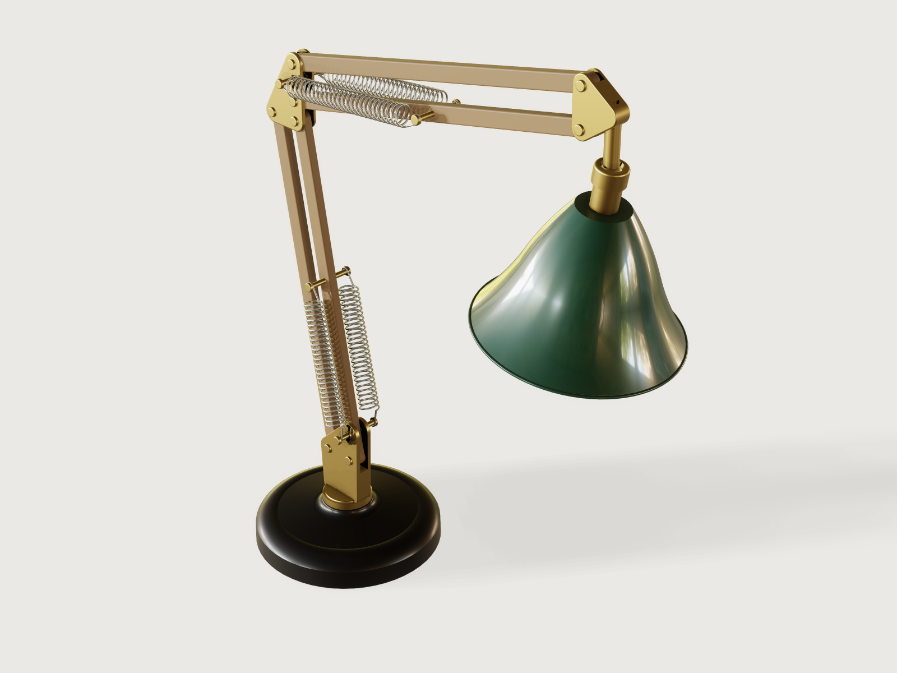

# Spring-balanced task lamp

An original two-arm desk lamp balanced by four extension springs: oak parallelogram arms, brass elbow and head plates, a
heavy cast-iron base, and a spun steel shade in deep green enamel that swivels on a free ball joint. It follows the
classic spring-balanced lamp type (not any maker's design) and proves the point of that type: **the torque about each
arm's pivots, computed from the model's own masses and solved joint angles and from real springs, stays within a stated
pivot friction over the whole sweep of poses.**



## What it shows

- **Two parallelogram loops.** Each arm is a closed four-bar of `mate.add` revolutes (turret, two oak bars, elbow
  knuckle, and knuckle, two oak bars, head block), so the elbow and the head stay level whatever the arms do. Both loops
  are solved in one `assembly.solve`.
- **Springs that are configurations following `t`.** A spring part's `span` is passed by `params` as a formula of `t`
  (`lower_span`, `upper_span`); each moment of the motion is a new configuration of the coil. The coil is the cheapest
  form that is honest about its wire and coil count (below).
- **The spring as a joint.** A spring is a two-force member of variable length: a `revolute` at its anchor stud, a
  `slider` along its axis to a separate end hook, and a `revolute` where that hook hangs on the arm's cross-pin. The
  loop closes through `assembly.solve`; the `slider`'s `jointDistance` is the difference between the coil's drawn length
  and the solved anchor span, and is asserted to be zero.
- **A ball mate left free.** The shade hangs on `Shade_swivel` (`mate.add`, kind `ball`), and turns by hand.
- **A means of preload, and fixings a fitter can follow.** Friction pivots with leather washers set the arms' holding
  moment; the turret is held by a screw, the ball by a screwed cap, the lamp holder by its nipple in the cup.
- **Mass from materials, balance from the solved model.** `material.preset`, `body.material` for the brass and leather; `variable.measure` of
  `mass`, `centerOfMass`, `jointAngle`, `jointDistance`, `position`, and `rotation` over the instances; `variable.output`
  for the torques; `assert.add` over `motion.check`.
- **Limits and pose.** `limits` on the arm mates (2° outside the sweep) and on the turret; the base turn is a public pose
  parameter.
- **Fits bounded from both sides.** Each fit's lower side is a `clearance` assertion with a `min` (its proven lower
  bound); its upper side is the same `clearance` as an output (`variable.measure`, the gap found between a real pair of
  points) under a `value` assertion with a `max`. Side play is measured per bar against its two plates and per plate
  against its bars, so one loose bar or one wide slot shows. A loosened fit fails as a tight one does.
- **Shared sizes are assembly variables.** The pin diameter, the cheek and oak bores, the cross-pin bore, the bar's width
  and thickness and the slot and cheek half-widths are each one variable of the assembly, passed to every part that uses
  them by `params`.
- **One part, many configurations.** `arm-bar` (four bars, three configurations by length and pin position), `pivot-pin`
  (eight instances, three configurations), `friction-pivot` (two, two configurations), `spring-stud` (four, two configurations),
  `spring` (four, two spans per moment) and `spring-tip` (four).

## The real thing

**Reference for the principle.** M J French and M B Widden, *The spring-and-lever balancing mechanism, George Carwardine
and the Anglepoise lamp*, Proc IMechE Part C 214 (2000), pp. 501-508, read in full (Lancaster eprints 20295):

- A mass `m` at radius `r` on an arm is balanced in every pose by a spring from a point a height `c` straight above the
  arm's pivot to a point at `b` on the arm, if the spring has zero free length and stiffness `k = mgr / bc` (its Eq. 1;
  arrangement of its Fig. 2b). With `F = k (a - l0)` and `l0` not zero, exact balance is impossible (its Eq. 8 to 10).
- With two arms on parallelograms, the spring on each arm balances that arm alone (its Section 3.1 and Fig. 3a). The
  lower spring carries the whole upper assembly as a weight at the elbow; the upper spring only the head.
- A spring wound with pre-tension has an effective free length shorter than its close-wound length; the paper says it is
  possible to reach zero or even a negative value (its Section 2.3). Their appendix notes that Carwardine knew friction
  keeps the arm in place in spite of small errors such as deviations from linearity.

This model applies Section 3.1 with the masses of the bodies it actually draws, and adds what the paper leaves out
for a real wound spring: its stated free length.

**The spring** is a stated calculation, not a catalogue item. Formulae and data read:

- `k = G d⁴ / (8 D³ N)` and the Wahl factor are as given on Firgelli Automations' spring-rate calculator page and
  RoyMech's *Springs helical*; `Ti = π τi d³ / (8 D)` and `Kw = (4C − 1)/(4C − 4) + 0.615/C` from RoyMech.
- Initial stress: RoyMech's table of best initial tension stress against spring index. At C = 11 the range is 55 to
  90 N/mm²; this model uses 83 N/mm², inside it.
- Music wire ASTM A228, modulus in torsion 79.3 GPa, design stress 45 % of minimum tensile strength (Master Spring &
  Wire Form Co., *Properties of materials*, read). The minimum tensile strength of 0.063 in (1.6 mm) wire is 293,000 psi,
  2020 MPa, from Gibbs Wire & Steel's data sheet No. 1004, *Phosphate coated music wire*, "Tensile Strength Table
  (ASTM-A228 spec)" (read; the standard itself was not). The allowable shear stress is then 45 % of 2020 MPa, 909 MPa.
- Coiled length with initial tension `Lz = 1.03 (n + 1) d` and the geometric limit `4 ≤ D/d ≤ 16` are from the
  Autodesk Inventor extension-spring help page.

| Spring (one design, four instances) | | |
|---|---|---|
| Wire, mean coil, index | 1.6 mm, 17.6 mm, C = 11 | music wire ASTM A228 |
| Active coils | 26 | |
| Rate `k` | 0.458 N/mm | formula above, G = 79.3 GPa |
| Initial tension `Ti` | 7.6 N | 83 N/mm² initial stress |
| Free length eye to eye `L0` | 72.7 mm | `1.03 (N + 1) d + 2 × 0.8 D` end hooks |
| Effective free length `e = L0 - Ti / k` | 56.1 mm | **not zero** |
| Largest force at the allowable stress | 73.5 N | 909 MPa, Wahl-corrected (Kw = 1.131); that force is reached at a span of 216.4 mm |
| Largest force in the sweep | 55.5 N | at a span of 177.3 mm (upper springs) |

**Why the springs are not zero-free-length.** Zero effective free length needs `Ti / k = L0`: 33.3 N of initial
tension, an initial stress of about 364 MPa with the end hooks counted (223 MPa counting the coiled body, `1.03 (N + 1) d`, alone), far
outside the 55 to 90 MPa RoyMech gives as the best range for this index. French and Widden describe winding springs to
zero free length as possible; I have no source for how far beyond the published range a winder can go, so this model
stays within it and is honest about `e`. The balance is then not exact: with `φ` the arm's lean from vertical, the net
torque is `sin φ · (m g r − n F b c / s)`, which does not vanish in every pose. The anchor height `c` is chosen so the
residual stays small over the sweep, and the check is that it stays within a stated pivot friction.

The reach along each arm is fixed (`lower_reach` 180 mm, `upper_reach` 170 mm), and the anchor heights are formulas
(`lower_anchor_height` 28.7 mm and `upper_anchor_height` 20.3 mm at the defaults) of the arm length and of an estimated
load (named estimates such as `head_fittings_mass`, checked against the measured masses), so that the balance follows the
public parameters. The upper reach is 170 mm so that, at the largest shade and the longest arms, the upper anchor stays
low enough (24.7 mm, worked out) for the stud to clear the knuckle's aux pivot pin above it; an assertion measures that
clearance. The checks use the measured masses, not the estimate.

| At the stored pose (from the model's outputs) | Lower arm | Upper arm |
|---|---|---|
| Measured load carried | 0.898 kg at the elbow | 0.617 kg at the head |
| Lean from vertical | −10° | 78° |
| Solved spring span | 151.8 mm | 167.0 mm |
| Force per spring | 43.9 N | 50.8 N |
| Gravity torque | −0.533 N m | 2.107 N m |
| Spring torque (two springs) | −0.518 N m | 2.055 N m |
| Net torque | −0.015 N m | 0.052 N m |

Over the whole sweep (73 samples) the largest net torque is **0.023 N m on the lower arm and 0.089 N m on the upper
arm**, against a friction of 0.293 N m per arm at the stated clamp (below).

**Parts and process.**

- *Base:* sand-cast iron, a turned-looking revolve with cast draft (the outer wall is 2.2°), filleted edges from the
  profile's own arcs, a bore for the turret's stem and a counterbored hole from underneath for the screw that holds it; black enamel.
- *Turret:* a turned brass foot and stem and two cheeks from 4 mm brass plate, joined; the stem is tapped M5 at its end
  for a steel shoulder screw (`turret-screw`) that comes up through the base, keeps the turret in when the lamp is lifted
  by its arm, and sets 0.1 mm of end float.
- *Arm bars:* oak slats 15 × 9 mm, grain along the length, rounded along their edges and at the ends, with brass pins in
  plain oak bores. They are drawn in a plain oak colour with no grain texture (`material.preset` `oak`, `"pattern": null`;
  see *Platform notes*). A pressed bronze bush would be used on a production
  lamp and is left out: it is hidden, and it does not change anything this model proves.
- *Knuckle and head plates:* 3 mm brass cheeks cut from sheet with a spacer, deburred and edge-rounded; a turned brass
  hollow stem on the head, Ø 12 with a Ø 7 bore for the flex, threaded M12 × 1 at its end (thread not drawn) for the ball.
- *Shade:* metal-spun 0.7 mm steel sheet, enamelled deep green outside and cream inside (the cream is drawn as a
  separate 0.25 mm layer of the same sheet, see *Platform notes*), with a rolled rim. A turned brass cup, fixed through the
  shade's top, holds the ball: its seat is open above the equator so the ball goes in from the top, and a brass cap
  (`ball-cap`, M22 × 1, thread not drawn) screwed over it closes the seat above the ball (mouth Ø 16.3 against the Ø 18 ball).
  The ball (`ball`) is a separate turned piece, tapped M12 × 1 right through, screwed onto the stem after the cap has been
  passed over the stem (the cap's mouth is too small to pass the ball), and locked on its thread with a thread-locking
  compound, so the shade's swivel torque cannot unscrew it.
  The drawn ball joint is free. The shade and lamp's centre of mass lies about 100 mm below the ball, so a real joint needs
  about 0.1 N m of friction to hold a tilt: a compressible liner in the seat, not drawn, tightened by the cap. **Nothing
  stops the shade turning about its own axis on the ball, so the flex can be twisted without limit.** A real lamp needs
  a stop, for example a pin in the cup running in a groove cut along a meridian of the ball, which leaves both tilts free.
  It is not drawn, because the ball mate cannot be limited ([A-004](../../3DCRAFT-FEEDBACK.md#a-004)) and a drawn
  groove would prove nothing here. The maker must add it and verify it.
- *Lamp:* an E27 holder sleeve and an A60-size bulb (E27 is the 27 mm Edison thread, read from Wikipedia's *Edison
  screw*; an A60 lamp is 60 mm wide, read from Wikipedia's *A-series light bulb*). Its hollow M10 nipple (Ø 7 bore, thread
  not drawn) screws into the cup's bore, so the holder's shoulder clamps the shade's top against the cup. The cap and
  the insulator inside the sleeve are not drawn; the bulb is drawn solid at a density that gives it the mass of a hollow
  bulb.
- *Flex:* H03VV-F 2 × 0.5 mm², the light two-core PVC flex for desk lamps. Read: Caledonian's data sheet gives 5 mm
  approximate overall diameter, a static bending radius of 4 × Ø and a flexing radius of 7.5 × Ø; RR Kabel gives 5.1 mm
  and the same radii; Nexans gives 5.9 mm as the largest diameter. A 90° turn into the holder inside the cup would need
  about 20 mm of radius (4 × 5.1), more than a Ø 22 cup holds, so the flex runs on the shade's axis instead. It enters the
  top of the head's nose, runs down the stem's Ø 7 bore, through the ball's Ø 12.2 bore and the cup's Ø 10.2 bore, and down
  the nipple's Ø 7 bore to the holder: every bore takes the largest 5.9 mm flex. It bends only where the shade is tilted,
  between the stem's end at the ball's centre and the nipple's top 16 mm below; both bore mouths are radiused (1.5 mm at
  the stem's end, 1 mm at the nipple's top), which also takes the sharp metal edge off a mains flex. **The tilt stop is
  measured:** posing the shade in scratch copies, the cap's crown clears the stem by 1.28 mm at the stored 10°, 0.37 mm at
  18°, 0.014 mm at 20.0° and overlaps it at 20.5°, so the shade tilts at most about 20° from the stem (the ball mate
  itself cannot be limited or posed by an assertion, [A-004](../../3DCRAFT-FEEDBACK.md#a-004)). **The bend at the stop is
  worked out, not measured:** an arc of radius R that leaves the stem's axis and joins the shade's axis touches them
  R tan(10°) from the stem's end, 6.7 mm for R = 38 mm (7.5 × 5.1, the flexing radius) and 7.8 mm for R = 44 mm (7.5 × 5.9).
  So the flex is straight again before the nipple's top, 16 mm away. At the stem's end the arc lies 0.6 to 0.7 mm off the
  stem's axis, inside the radiused mouth (bore radius 5 mm there). Where the radius ends, 1.5 mm up, it lies 0.45 mm off,
  against the 0.55 mm a Ø 5.9 flex has in the Ø 7 bore. So the flex can bend at its flexing radius at the stop.
  Outside, the flex leaves the nose in a loose loop and runs along the arms in clips to the base. The flex and its clips
  are not drawn.
- *Springs:* close-wound and stretched in service from the 73 mm free length. Each end is an open hook: a half ring of
  wire with a 5.6 mm gap and a straight leg to the coil, so it goes onto a Ø 5 shank between the heads of a stud or cross-pin.

**Fits.** Brass pivot pins Ø 5.0 (`pin_diameter`) in cheek bores Ø 5.2 (`cheek_bore`, 0.1 mm radial) and oak bores Ø 5.3
(`oak_bore`, 0.15 mm radial); bars 9.0 mm (`bar_thickness`) in a 9.8 mm slot (`cheek_inner` 4.9 mm, 0.4 mm a side); turret stem Ø 16.0 in the base bore Ø 16.4; turret seat 0.1 mm above the boss; ball
Ø 18 in a seat Ø 18.3. These are stated running fits, not fit classes, and each is bounded from above as well as below
(*Checks*). The studs screw into an M5 tapped hole in the cheek (drawn at the Ø 5.2 of the other holes; the stud's thread drawn at
Ø 4.8, clear of it, F-014) until their collar bears on its
outer face. The spring cross-pins are pressed: Ø 5.0 in a Ø 4.9 oak bore, 0.05 mm radial interference, listed as a contact.
A `clearance` between two bodies is their smallest gap, so each fit is drawn with its own gap the smallest of its pair:
the pin heads stand 0.3 mm off the cheeks (more than the cheek bores' 0.2 mm upper bound), and each stud's thread
stands 0.2 mm clear in its hole (more than the collar's 0.1 mm upper bound). A loose bore or an unseated collar then
shows instead of hiding behind another gap.

**Pivot friction, and where it comes from.** Bars float 0.4 mm a side in their slots, so most pivots have only journal
friction. The two pivots that hold the arms have a means of preload: `friction-pivot`, at the main pivot of each arm
(`Lower_main` at the turret, `Upper_main` at the knuckle). It is an M5 tension screw through both cheeks with a clamp nut
and a conical spring washer, and a 0.5 mm leather washer each side of the bar, in the 0.4 mm space between bar and cheek.
The leather is drawn at its free thickness, so it overlaps the bar and the cheek by 0.05 mm each side (listed as
contacts): squeezed, it fills the space, and the screw's tension passes through cheek, leather, bar, leather, cheek
without bending the cheeks. That matters at the turret, whose 4 mm cheeks are too stiff to be pulled together through
a gap. The screw head and the spring washer are drawn 0.3 mm off the cheeks.

The holding moment is `2 μ F r_m`: two faces, μ = 0.3 (the low end of leather on wood, 0.3 to 0.4, Engineering
Toolbox's *Friction and friction coefficients*, clean and dry), and the mean radius for uniform wear, the more cautious
of the two usual assumptions, `r_m = (Ro + Ri) / 2` = 4.88 mm for a washer of radii 2.75 and 7 mm (uniform pressure
would give 5.18 mm). Both formulas are written from engineering practice, not from a source read here. The design sets
the clamp at `F` = 100 N, so `arm_friction` = **0.293 N m per arm**; nothing in the model measures the clamp.

**What the fitter must set.** The arms stay where they are left **provided the clamp is at least 31 N** (the
largest net torque of the drawn springs and lamp, 0.089 N m), and **at least 80 N to cover a spring rate of ±10 %**
(the largest net torque of the tolerance runs below, 0.233 N m). A fitter checks it with the springs unhooked and the arm
upright: the bar must need at least 0.23 N m to start turning on its friction pivot, a pull of 0.71 N (about
72 g) square to the arm at 330 mm from the pivot. Journal friction at the other six pivots is ignored, which is
conservative.

**The spring is drawn honestly and cheaply.** The coil has its real wire and real coil count, at the pitch its stretched
length gives. Each turn is two half-turn tori (`feature.revolve` of the wire section through 180°), near and far, tilted
either way by the half-turn's own lead, and joined end to end; `feature.pattern` repeats the two banks along the axis. Each
joint is tangent, the height of the wire between joints differs from a true helix by a fraction of the pitch, and the
far end of the spring meets a separate end hook (`spring-tip`) that the slider joint carries. In a side-by-side render
against a true helical sweep of the same wire and coil count it read the same. Each end hook is a half ring and a
straight leg, not a formed hook. The span the coil is drawn at is rounded to 0.25 mm (`span_quantum`): the moments of
the motion then share configurations (cheaper bake), and the sliding joint carries the difference to the solved span,
asserted to stay within half that step. See *Platform notes*.

**Safety.** The model proves a balance within a stated friction, and that the springs stay within the stress limit above.
It proves nothing about the wiring, the lamp's heat, or mains safety. Whoever makes and sells a real lamp approves it
against the luminaire safety standard that applies where it is sold.

## Parts and assembly order

| Part | Count | What |
|---|---|---|
| `base` | 1 | Cast-iron base, revolved, with a bore for the turret's stem and a screw hole from below |
| `turret` | 1 | Brass foot and stem, two cheeks carrying the two lower pivots and the spring studs |
| `turret-screw` | 1 | Steel shoulder screw that keeps the turret in the base |
| `arm-bar` | 4 | Oak slats of two arms |
| `knuckle` | 1 | Brass elbow plate with four pivots and the upper spring studs |
| `head-block` | 1 | Brass head block with a stem for the ball |
| `ball` | 1 | Turned brass ball, screwed onto the stem |
| `shade` | 1 | Spun steel bell, outer shell and cream liner, with a brass ball cup (three bodies) |
| `ball-cap` | 1 | Brass cap screwed over the cup, keeps the ball in |
| `lamp` | 1 | E27 holder and A60 bulb (two bodies) |
| `friction-pivot` | 2 | M5 tension screw, nut, spring washer, two 0.5 mm leather washers (five bodies), at the main pivot of each arm |
| `pivot-pin` | 8 | Brass pins in three configurations by length: 6 pivots, 2 spring cross-pins |
| `spring-stud` | 4 | Brass M5 studs with a collar, on the cheeks' outer faces |
| `spring` | 4 | Coil and rear end hook, per arm two spring configurations per moment |
| `spring-tip` | 4 | The far end hook of each spring |

To build one, in order:

1. Pass the turret's stem into the base bore and screw the shoulder screw up into it from under the base.
2. Press the spring cross-pins into the two main bars and rivet over their second heads.
3. Set the bars into the turret's and knuckle's slots. At the six plain pivots pass a pin through the cheeks and bar and
   rivet its second head. At the two friction pivots (`Lower_main`, `Upper_main`) slip a leather washer either side of the
   bar, pass the tension screw, fit the spring washer and clamp nut, and tighten until the pivot needs the torque given
   above to turn (springs not yet hooked).
4. Close the upper arm on the head block the same way (pins riveted).
5. Screw the four studs into the cheeks until their collars seat.
6. Hook the springs on the studs and cross-pins: their open hooks go on between the heads, stretching each spring by
   hand with the arm held.
7. Screw the lamp holder's nipple up through the shade's top into the cup's bore, so its shoulder clamps the shade
   against the cup.
8. Pass the ball cap over the head's stem and screw the ball onto the stem with thread-locking compound. Thread the flex
   down through the nose, the stem and the ball, then through the cup and the nipple, and wire the holder. Drop the ball
   into the cup's open seat, screw the cap down over the cup, and fit the bulb.

## The motion

`t` plays a closed sweep of poses. Each arm's lean from vertical follows a cosine (`lower_angle`, `upper_angle`),
`lower_angle` swinging from −28° (back) to +46° (forward) and `upper_angle` from 44° (up) to 108° (down past level), out
of phase, so the head traces a closed path over the desk and the shade stays level through the two parallelograms.
`t = 0` is the stored pose, with the shade tilted 10° on its ball by its placement. **The cycle closes on itself**
(`meta.json` `motion`).

**What is free.** `assembly.solve` reports 3 degrees of freedom, all three on `Shade_swivel`: the shade turns on its
ball by hand in all three directions. The base's turn (`Turret_swivel`) is the public parameter *Base turn*, driven by
that parameter and held at it over the motion; limits of ±170° model a stop on the swivel (a stored value, not a
collision check). The ball mate holds no orientation: its turns stay where the placement sets them.

## Parameters

| Parameter | Range | Default | What it does |
|---|---|---|---|
| Arm length | 290 to 350 mm, step 10 | 330 mm | Length between pivots of both arms; the springs' anchor heights follow, their reach along the arm stays at 180 and 170 mm |
| Base diameter | 180 to 220 mm, step 5 | 180 mm | Diameter of the base; below 180 mm, with the longest arms and the largest shade, the lamp's centre of mass would be within 10 mm of the rim |
| Shade diameter | 150 to 190 mm, step 5 | 170 mm | Diameter of the shade; the anchors follow its mass |
| Base turn | −170° to 170°, step 5° | 0° | Pose of the lamp on its swivel |

## Checks

**At the stored pose (`document.check`, and at `t` = 0 at each corner of the ranges):** the assertions below, and these
fits, bounded from both sides:
- the pins in each bar's oak bores 0.1 to 0.25 mm (0.15 nominal), the pins in each plate's cheek bores 0.05 to 0.2 mm
  (0.1 nominal), the bars in each slot 0.2 to 0.6 mm a side (0.4 nominal). The lower side is a `clearance` assertion per
  bar or plate; the upper side is one `value` assertion on the largest of the outputs: per bar for the oak bores, per
  plate for the cheek bores, and for side play both per bar (each bar against its two plates) and per plate;
- *Leather washers fill the slot at the lower/upper friction pivot*: the leather's thickness, measured as the two
  washers' `volume` over twice their area, less the measured side play in that slot (the plate's `clearance` output), is 0.04 to
  0.2 mm, a squeeze of 0.02 to 0.1 mm a side (0.05 nominal). A loose or a crushed leather fails it (mutations below);
- the spring cross-pins pressed into their bars (`overlap`, is);
- the studs' collars seated on their cheeks within 0.02 to 0.1 mm (the lower side per plate, the upper side per stud);
- each fixing, with the same split: the lamp nipple in the cup's bore (0.05 to 0.2 mm), the holder shoulder under the shade's top (0.02 to 0.1 mm), the ball
  in the cap's and the cup's seats (0.05 to 0.3 mm), and the turret's shoulder screw held to 0.05 to 0.15 mm of the base;
- the upper studs clear the knuckle's aux pivot pin by at least 0.3 mm (5.2 mm at the defaults; a minimum only);
- *Load estimates match the measured masses*: the design estimate of the load on the lower arm within 6 % of the measure.

**Over the motion (`motion.check`, 73 samples, at the defaults and at the corners of the ranges):**

- *Lower arm balances within its pivot friction* and *Upper arm balances within its pivot friction*: the net torque is
  within `arm_friction` (0.293 N m, from the friction pivot above). Gravity comes from the `mass` of the measured groups and
  the measured `jointAngle`; the spring from the real force at the solved span, with the anchor height itself worked out
  from the solved span and angle, so a stud in the wrong place shows. Largest value at the defaults: 0.023 and 0.089 N m.
- *Springs stay within their stroke, lower/upper*: each span between the free length plus 50 mm (a margin of my own
  choosing, with no source behind it) and the span at the allowable force (216.4 mm); the
  sweep uses 151.3 to 161.4 mm below and 156.0 to 177.3 mm above.
- *Drawn lower/upper springs reach their pins*: the drawn coil's length, rounded to 0.25 mm, is within half that step of the
  solved span at every sample (largest 0.124 mm).
- *Elbow follows the lower arm*: the knuckle's measured height against the closed form `pivot_z + L cos(lean)`.
- *Head stays level*: the x and y components of the head's rotation (its turn about z is the base turn) within 0.05°.
- *Shade rim clears the desk*: the lowest point of the shade stays at least 20 mm above the desk (71 mm at the defaults).
  The arm `limits` sit 2° outside the sweep. With both arms at those limits at once, the largest shade and the shortest
  arms, the rim is **9.70 mm** above the desk, measured on the model (`boxMin` of the shade, a scratch run with the two
  drives set to the limits; 29.29 mm with the longest arms). No sample of the motion puts both arms at their limits, so
  this is a measurement, not an assertion.
- *Lamp does not tip*: the measured centre of mass of the whole lamp stays at least 10 mm inside the base's rim (at most
  62.5 mm from the axis at the defaults, against a base radius of 90 mm).
- No collision between bodies at the 121 moments the tool checks at the defaults and the 31 it checks at each corner of
  the ranges, other than the listed contacts in `meta.json`: each spring's two end hooks, where the wire of the hook
  runs into the coil (one wire, drawn as separate bodies); the cross-pins pressed into the oak; the shade's shell and its
  cream liner (one sheet, drawn as two bodies).

**Mutation tests**, in a scratch copy, each at 73 samples (largest net torque over the sweep, lower and upper arm):

| Mutation | Net torque (N m) | What failed |
|---|---|---|
| Turret's spring stud drilled 5 mm higher, in the part only | 0.375, 0.089 | *Lower arm balances* and *Drawn lower springs reach their pins* (4.8 mm) |
| Upper anchor height 3 mm too large | 0.023, 0.320 | *Upper arm balances* |
| Shade in 1.4 mm sheet instead of 0.7 mm, anchors not redesigned | 0.535, 0.800 | both *balances*, *Load estimates*, the holder's clamp on the shade |
| Wire 1.5 mm instead of 1.6 mm, anchors frozen at the design's values | 0.411, 0.459 | both *balances* |
| Oak bores 5.8 mm (`oak_bore`, 0.4 mm radial) | 0.023, 0.089 | *Every bar's pins have their running fit in the oak* (0.40 mm against 0.25) |
| Turret slot 1 mm wider, in the turret only | 0.023, 0.089 | *Every bar has its side play in every slot* (0.90 mm against 0.6) and *Leather washers fill the slot at the lower friction pivot* (−0.40 mm) |
| Only the upper aux bar 8.4 mm thick, inside its published range (the reviewer's) | 0.020, 0.086 | *Every bar has its side play in every slot* (0.70 mm against 0.6) |
| Only the upper right stud's collar 0.3 mm off its cheek, inside its range (the reviewer's) | 0.023, 0.089 | *Every stud seats on its cheek* (0.20 mm against 0.1; the stud's 0.2 mm thread gap caps the gap found) |
| Cheek bores 5.6 mm (`cheek_bore`, 0.3 mm radial) | 0.022, 0.088 | *Every plate's pins have their fit in the cheek bores* (0.30 mm against 0.2) |
| Leather 0.25 mm instead of 0.5 mm: loose | 0.023, 0.089 | both *Leather washers fill the slot* (−0.15 mm) |
| Leather 0.75 mm: crushed | 0.023, 0.089 | both *Leather washers fill the slot* (0.35 mm) |

**Tolerance and load margin.** These runs (scratch copy, 73 samples, anchors left as designed) show how much the friction
covers beyond the drawn springs and lamp:

| Change | Net torque, lower and upper | Result |
|---|---|---|
| Spring rate 10 % below nominal | 0.173, 0.233 N m | holds |
| Spring rate 10 % above nominal | 0.201, 0.186 N m | holds; its force at the longest stretch, 60.5 N, stays under the allowable 73.5 N |
| 50 g more at the head (a heavier bulb, or a cord's share hanging from the head) | 0.109, 0.225 N m | holds |

So, with the clamp set as above, a spring made to a rate tolerance of ±10 % and up to 50 g more at the head still leave
each arm where it is put. A
cord is not modelled: one clipped along the arms and hanging from the head must stay within that 50 g, or the anchors be
reset for it. Beyond that the arms would need adjustable anchors, which this design does not have.

**What the samples do not cover.** Nothing between the samples is claimed; the sweep is one cosine in each arm. The
spring forces are the static formula, without hysteresis, fatigue or hook-end stress. The lamp's balance is asserted at
the base's turn of the stored pose and at the corners of the range.

## Files

- `task-lamp.3dcraftasm`: the packed assembly.
- `parts/*.json`, `build.json`: the sources.
- `meta.json`: title, tier, contacts, preview framing and the tool's numbers.
- `exports/task-lamp.step`: the assembly with its structure.
- `preview.png`: the picture (`look.rotation` 180: under the Workshop environment's warm key light at rotation 0 the oak
  and the brass read orange and run together).

## Rebuild

```sh
tools/assemblies.py build task-lamp
tools/assemblies.py render task-lamp
tools/assemblies.py check task-lamp
```

## Difficulty

**6/10**, scored by the reviewer: two parallelograms and four spring loops closed through sliders, springs as
configurations following `t`, statics from measured masses, and a solver drift to work around; no couplings or
subassemblies.

## Platform notes

- A helical sweep of the coil is too heavy to follow `t` at this tier ([A-025](../../3DCRAFT-FEEDBACK.md#a-025)). Measured for one 30-coil spring at 120 frames, on a machine at load 14 to
  39: a true helical sweep 43 s (about 200 ms per configuration); the half-turn revolves used here 5 s (about 23 ms);
  plain tilted rings 0.06 s, but they read as rings, not as a coil. Hence the half-turn revolve pattern above.
- An instance whose configuration has a failed feature is placed from a partial regeneration and `document.check` of
  the assembly says ok ([A-023](../../3DCRAFT-FEEDBACK.md#a-023)): the parts'
  public ranges are therefore kept to what the assembly passes, and each is proven by `check-range`.
- A `material.preset` applied before a later feature takes the body is known to the part's own `mass`, not to an instance's
  ([A-024](../../3DCRAFT-FEEDBACK.md#a-024)): the oak bars set their material
  after the last feature.
- `face.appearance` is lost on an assembly's instances ([A-035](../../3DCRAFT-FEEDBACK.md#a-035)): the cream inside of the shade is
  therefore a separate 0.25 mm layer (`Liner`) of the 0.7 mm sheet, so the shell and liner together carry the sheet's mass.
- A free revolute the solve does not reach can still be moved by it: with the base's turn left free, the first version
  solved to about 7° of base turn ([A-036](../../3DCRAFT-FEEDBACK.md#a-036)). The base's turn is therefore a
  public parameter at 0°, which is also the pose a maker would want.
- A solid texture does not turn with an instance's placement ([A-015](../../3DCRAFT-FEEDBACK.md#a-015)): an oak grain on a
  bar turned by a joint runs across the bar. The moving oak bars therefore have no texture; the grain returns when 3DCraft
  fixes A-015.
- `boxMin` of the shade is "not proven closely enough to be a value" as an output ([F-122](https://github.com/johancoppens/3dcraft-examples/blob/main/3DCRAFT-FEEDBACK.md#f-122)):
  *Shade rim clears the desk* is therefore an assertion on `boxMin` itself, which needs only its proven bound.
- An output of `clearance` is known at the gap found where the same assertion with a `max` reads not proven
  ([A-041](../../3DCRAFT-FEEDBACK.md#a-041), with [A-034](../../3DCRAFT-FEEDBACK.md#a-034)): every fit's upper side is
  therefore asserted on the output, and its lower side on the `clearance` assertion's proven bound.
- A multi-body instance is measured by its body path (`Shade/Shade`, an extension of [A-007](../../3DCRAFT-FEEDBACK.md#a-007)).
- A ball mate has no variables ([A-004](../../3DCRAFT-FEEDBACK.md#a-004)): the shade cannot be driven or limited, so it
  stays where it is placed.

## Licence

[CC BY 4.0](../../LICENSE-CC-BY-4.0.md); credit line in the [README](../../README.md#licence).
