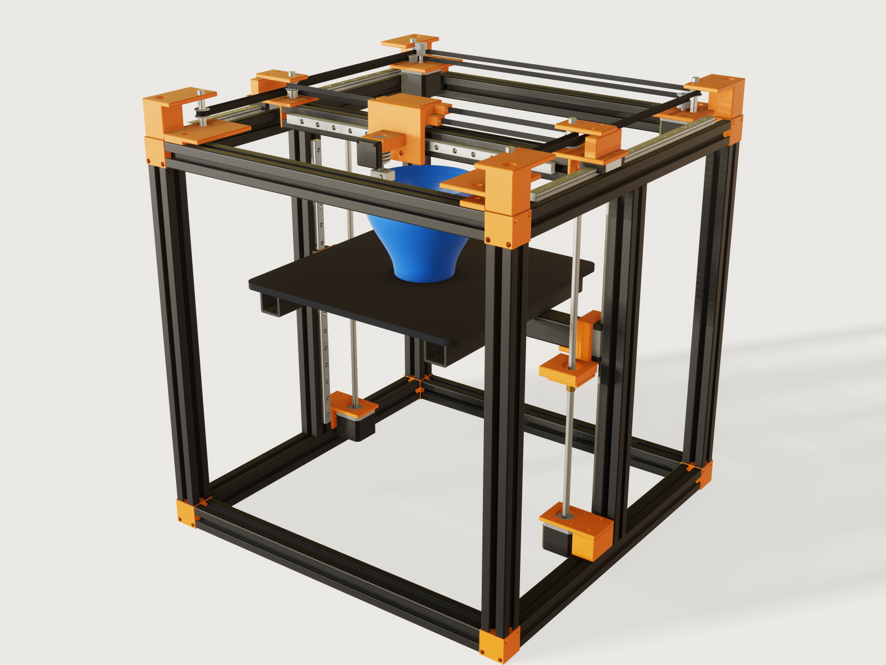

# CoreXY 3D printer

A desktop CoreXY FDM printer of the 250 mm class: a cube of black anodised 30 mm T-slot profile, MGN12 rails and
carriages on X, Y and Z, two NEMA 17 motors at the rear corners driving two GT2 belts in the CoreXY layout, a Z bed
carried on two rails and two T8 lead screws with floating nut plates, and a blue vase printed as a time-lapse: the
timeline runs the nozzle round the vase's rim while the bed drops, the motors turn, the idlers turn and the belts
follow. Every motion comes from mates and couplings; the belts' straight runs are configurations of `t`.



## What it shows

- **CoreXY as two linear couplings.** X and Y are two `slider` mates on real rails (the gantry on its Y rails, the
  toolhead on the X rail); motors A and B are `revolute` mates and are the drive. Two `coupling.add` of kind `linear`
  write the CoreXY equations, `R θA = X - Y` and `R θB = X + Y`, so a motor angle commanded from `t` moves the carriage
  through the couplings: nothing places the carriage by a formula.
- **A screw coupling and a planar mate on the Z axis.** Each bed screw is a `revolute` mate and a `cylindrical` nut
  tied by a `screw` coupling with the 8 mm lead. The nut is on a printed plate joined to the bed by a `planar` mate: it
  floats in X and Y while its rotation is held. The screw axes stand a real 0.3 mm off the bed's nominal seats
  (`z_misalignment`), so the planar's `x` and `y` are solved values, measured and asserted.
- **Configurations that follow `t`.** A vase whose height is a parameter (`params`: a body of revolution re-drawn at
  each moment) and eight belt spans whose length follows the commanded motion, each a new configuration of one cheap
  part.
- **One T-slot part placed many times**: 15 instances, three lengths (`params`: the 12 frame edges and the two mid uprights at the frame size less 62 and 60 mm, the gantry beam at less 96 mm), copied from the 3DCraft examples'
  [T-slot profile](https://github.com/johancoppens/3dcraft-examples/tree/main/examples/02-t-slot-profile) (MIT), with
  datums added. One corner bracket part mirrored by a `hand` parameter and rotated half a turn gives all four
  top corners.
- **Limits on the rails.** `Gantry_Y`, `Carriage_X` and `Bed_lift` carry `limits`: the gantry's crash into the corner floors at the rear and, asymmetrically, at the front the fan's on the front rail and the head plate's on the corners, the head's into the gantry ends, the Z carriage's travel on its rail.
- **Rigid subassemblies** for the frame (36 instances), the gantry, the toolhead and the bed, each one solver body in
  the machine; `variable.publish` passes the build size down.
- **A nozzle trace** while it plays: `view.trace {"point": "Toolhead/Hot end/Nozzle tip"}` draws the spiral; a trace is view
  state and is not saved with the document (A-005).
- **Measured checks.** `variable.measure` with `position` and `jointAngle` turns the solved poses into outputs; the
  assertions compare them, never `t`-derived formulas of the same variables.

## The real thing

**References read.**

| Source | What was read | Used for |
|---|---|---|
| HIWIN MGN/MGW catalogue (GW-11-5-EN-2207-K, damencnc copy), Table 3.79 and 3.81 | MGN12H block: H 13, H1 3, W 27, B 20, C 20, L1 32.4, L 45.4, M3 x 3.5; MGN12 rail: WR 12, HR 8, D 6, d 3.5, h 4.5, P 25 mm | `mgn-rail`, `mgn-carriage` |
| Songyang SY42STH38-1684A drawing (Pololu 2267) | NEMA 17: 42.3 mm max square, 31 ±0.2 mm bolt spacing, 4 x M3 x 4.5 deep, boss Ø22 x 2, shaft Ø5 x 24 ±1, body 38 ±1; max axial force 10 N | `nema17`, motor mounts |
| Gates *Light Power & Precision Drive Design Manual* (PowerGrip GT3), sections on 2MGT belts and sprockets | 20-groove sprocket P.D. 12.73, O.D. 12.22 mm; overall belt thickness 1.52 mm (Table 15); nominal flange height 1.5 mm; 2MR-20S-06 flange 0.685 in; flanged face width belt + 1.0 mm; Table 9 idlers: inside minimum 12 grooves, backside minimum 0.50 in O.D.; a loaded sprocket should have at least 60° of wrap and 6 teeth in mesh | `gt2-pulley`, belt stack, idler sizing |
| Rubix catalogue listing of Gates 2MGT | pitch 2.0 mm, tooth height 0.71 mm, belt height 1.52 mm | backing thickness (own judgement of 0.7 mm drawn) |
| Gates PowerGrip GT2 design manual, section II-3 | the groove profile is Gates' own and is not published ("designed and developed exclusively by The Gates Rubber Company") | why the groove here is simplified |
| NMB and NSK F695ZZ data sheets (5 x 13 x 4 mm, flange 15 x 1 mm) | | the two back-to-back smooth idlers |
| Makerstore listing 17HD40005-300N, seen in a web search result (the page refused fetching) | that a 40 mm NEMA 17 with an integrated TR8x8 lead screw is a catalogue item | the Z motors; their axial capacity is not stated anywhere I read |
| Handson Technology data sheet, flanged T8 nut (SKU MCH1178) | Flange Ø22 x 3.5, 4 x Ø3.5 on a Ø16 circle, body Ø10.2, 15 mm overall; Tr8x8-2P, 4 starts, 8 mm lead | `float-nut` |
| Wikipedia, *CoreXY*, citing Moyer's corexy.com; corexy.com/theory page | `Δx = ½(ΔA + ΔB)`, `Δy = ½(ΔA − ΔB)`; both motors one way is X motion, opposite is Y | the coupling equations (after renaming, see *The motion*) |
| RepRap wiki, *Groove Mount* | Overall diameter 16 mm, groove diameter 12 mm, groove width 4.64 mm | the heat sink's neck and its clamp; the 3.7 and 3 mm collars either side are my own judgement |
| E3D V6 heater block drawing (Edition 8.1, 24/06/2016) | block 23 x 16 x 11.5 mm, M6 x 1 nozzle, 6 mm cartridge bore | `hot-end`'s heater block |
| 3dprint.wiki (E3D V6 page); reseller copy of E3D's description | 22.3 mm heat sink diameter; 62 mm overall length | `hot-end` |
| SolidCore CoreXY guide; *mechanical-design-handbook* z-banding page | an Oldham coupling takes a screw's misalignment; a sliding middle disc allows up to 2 mm off-centre | the floating nut plate |
| PrusaSlicer spiral-vase guide (printago) | one perimeter, Z rises continuously, no top layer | what `t` plays |

**The CoreXY layout used here.** Each belt is a closed loop of GT2, level one above the other (10 mm apart). Motor A
(rear left, upper level) and motor B (rear right, lower level); from the toolhead, belt A runs to the left gantry idler,
back to motor A, across the rear to the right rear idler, forward to the right front idler (a half wrap), back to the
right gantry idler (its smooth idler, the belt's back on it) and to the toolhead. Belt B is the mirror image. The length
of each belt is the same at every position of X and Y, which is the point of the CoreXY layout: X and Y cancel in the
sum of the moving straight spans. Printed toolhead and gantry parts give the anchor points. This layout puts the belts
on stacked levels, so no belt crosses another.

**Motor A's shaft (a real limit of this layout).** The Songyang drawing gives 24 ±1 mm of shaft from the flange face, and that is how every motor here is drawn except one. Motor A's pulley runs on the upper belt level, 10 mm above motor B's, and the pulley and its 7 mm hub end 45.5 mm above the frame's top while the flange sits at 14: a 24 mm shaft stops inside the hub short of the set screw. Motor A is therefore specified with a 30 mm shaft (`shaft_length` of `Motor A stator`), reaching the set screw, which is reached from above and the side once the roof is cut back around it. No catalogue drawing of a 30 mm shaft was found: a builder should order a NEMA 17 with a 5 mm shaft of at least 30 mm from the flange face, a made-to-order length, and verify the length before use. Motor B's pulley stands on the standard shaft, its hub below the teeth.

**Fits (stated, not a standard's fit classes).** The MGN carriages are drawn with their channel 0.3 mm wider each side
than the rail and 0.5 mm above it, a kinematic clearance standing in for the balls (asserted between 0.25 and 0.35 mm on
one carriage of each axis). The hot end is held by its groove neck, in a two-piece clamp with its bores 0.1 mm larger than the 16 mm and 12 mm of the neck and its ridge 0.1 mm clear of the groove's sides axially (the fins stay free in the fan's air). Idlers and pulleys turn about
5 mm bolts and shafts in 5.1 mm bores (0.05 mm radial clearance, asserted between 0.02 and 0.1 mm for a toothed idler, a smooth idler and a motor pulley); the nut's thread is drawn line-on-line with the
screw (`F-014`, listed in `meta.json` contacts). The floating nut plate is a 4 mm PETG plate on a slip fit in the
bracket's underside; the model gives it 0.3 mm of misalignment to absorb; its tongues are not drawn and the planar
angle is held at 0 instead. The drawn belts leave a 0.05 mm gap to their wraps, and end inside the belt clamps, whose slot carries a 2 mm serration that the belt's teeth mesh (teeth drawn on the pulleys and the clamps; the strip itself is the backing).

**The belt pitch line.** The strands' positions come from the pitch radius of the toothed pulleys (12.73 / 2 mm, from
the Gates table) and for the smooth back-idlers from the backing thickness: the idler's rolling radius 6.5 mm plus
0.555 mm to the pitch line (my reading of a 0.81 mm backing, `1.52 - 0.71`, with the pitch line 0.25 mm in from the
land, an approximation of Gates' pitch differential). The drawn strip is the backing only (0.7 mm, no teeth); teeth are
drawn only on the 20-tooth pulleys and idlers, and the groove's round form is my simplification, not Gates' curve (its
real profile is proprietary; only its P.D. and O.D. are published).

At the default size each belt has a pitch length of 1586.5 mm: 724.0 mm of moving straight spans (four per belt), 801.4 mm of static runs and 61.1 mm of wraps (`belt_a_length`, `belt_b_length` are outputs of the measured value).

**Processes and materials.**

| Part | Process | Material |
|---|---|---|
| `t-slot-profile` (15) | Extruded aluminium 3030 cut to length (the 3DCraft examples' section, MIT, datums added); black anodised | EN AW-6063 T66, black anodised |
| `box-beam` (3) | 30 x 30 x 3 mm box section cut to length | Aluminium, black anodised |
| `corner-cube` (8) | FDM printed | PETG, orange |
| `corner` (4) | FDM printed; one M5 idler bolt through the roof into a tapped floor with steel spacer sleeves, a long M8 through the tower into the upright | PETG, orange; steel bolts and spacers |
| `gantry-end` (2), `bed-bracket` (2), `z-mount` (2), `head-plate` | FDM printed | PETG, orange |
| `float-nut` (2) | FDM printed plate, brass nut (bought) | PETG, orange; brass |
| `mgn-rail` (5), `mgn-carriage` (5) | Bought (HIWIN or compatible) | Hardened steel |
| `nema17` (4) | Bought | Steel, aluminium |
| `gt2-pulley` (8) | Bought GT2 20T aluminium pulleys and idlers | Aluminium |
| `back-idler` (2) | Two F695 flanged bearings back to back | Bearing steel |
| `lead-screw` (2) | T8 x 8 mm lead screw, bought | Steel |
| `hot-end` | Bought V6-class hot end | Aluminium, steel, brass |
| `build-plate` | Cut aluminium plate with a PEI surface | Aluminium, PEI |
| `belt-span` (8), static belt runs and wraps | Bought GT2 6 mm belt | Polyurethane, steel cords |
| `vase` | The print itself | PETG, blue |

**Printing.** Printed parts carry 0.3 to 1.2 mm chamfers on their edges. Part by part, in the orientation for the
bed: `corner` and `gantry-end` stand on their floor, with supports under the roof (the fork); `corner-cube` flat on one
face; `z-mount` with the plate flat on the bed and the post upwards (the 62 mm plate needs no supports), `bed-bracket`
with the carriage face on the bed and supports under the lobe and the shelf; `head-plate` with the plate's back on
the bed (the bridge stands up), `Hot end clamp` and `Hot end cap` on their outer faces, `belt-clamp` on its bottom
face with its slot upwards, `float-nut`'s plate flat. Walls: `measure.thickness` proves at least 1.2 mm on `bed-bracket`, `float-nut`'s plate, the corner cube (1.3 mm at its M5 bores: the cube is 32 mm so that the bores keep a real wall and the screw heads a full seat), around `belt-clamp`'s screw bore and around `gantry-end`'s bores. On the whole of `gantry-end`, on `head-plate`, the hot end clamp and cap and on `z-mount` it finds 1.3 to 4.25 mm but does not prove the least (the reports stand as *not proven*, *Platform notes*). `corner` carries no wall assertion, because `measure.thickness` does not prove one there. The idler axis lies 13.42 mm from the motor's axis at the two rear corners, for the geometry the belts demand, so the floor is not bored through: the motor's boss sits in a blind recess (R11.2, 2.2 mm deep from the underside), the shaft passes a R3.5 hole, and the Ø4.2 tap is blind, 2.8 mm from the top, in the solid floor above the recess. The measure finds 1.45 mm on the body and 1.40 mm on the hole faces; its lower bound stays 0.12 mm, the distance across the corner between the edge of the tap's bottom and the edge of the recess's ceiling, a local neck and not the wall the thread bears against, which is the 2.8 mm of solid floor on the motor's side. The price is about 3.5 turns of M5 in PETG at those two holes: **tighten them only to seat the spacer stack**, and a heat-set insert does not fit (from above the blind hole is too short for one, from below a Ø6.4 insert reaches into the recess, and the idler axis cannot move because both belt tangents fix it). The two front corners have no motor and keep a through tap, 6 turns. The 3MFs in `exports/` are per
configuration and per body (four corners, each hand of end, bracket and mount, the head plate and each clamp half apart) and in the part's mating
orientation (*Platform notes*). The 5 mm PETG floors of the corner brackets are cantilevered out to 70 mm under
the motors and the belt tension: this model does not prove them; a real build needs ribs under them or aluminium plates.

**Not modelled.** The screw heads, nuts, T-nuts and washers (every fastener the assembly order names has its hole in the drawn parts); the printed cable chain and wiring; the bed's three-point levelling; belt tension
adjustment; the bed's heater; a spool and extruder (a direct drive or Bowden feed would sit on the toolhead); the belt's
elasticity. The machine is not a load-rated design: the Z motors take the bed's weight on their own bearings as
integrated T8 motors do (a generic NEMA 17 drawing gives only 10 N axial, so a real build should check its motor's
thrust rating or add a thrust bearing); nothing in the model proves stiffness, thermal behaviour or print quality.

## Parts and assembly order

| Part | Count | What |
|---|---|---|
| `t-slot-profile` | 15 | 3030 frame edges, side uprights, gantry beam |
| `box-beam` | 3 | Bed arms and cross beam |
| `corner-cube` | 8 | Three-way printed corners of the frame |
| `corner` | 4 | Top corner brackets: rear with motor seat, front with idler; idler spacer sleeves, belt runs and wraps |
| `mgn-rail` / `mgn-carriage` | 5 / 5 | Y, Z and X axes |
| `nema17` | 4 | Motors A, B and the two Z motors |
| `gt2-pulley` | 8 | Two motor pulleys, six toothed idlers |
| `back-idler` | 2 | Two F695 stacks, smooth idlers |
| `gantry-end` | 2 | Printed ends of the gantry beam |
| `head-plate` / `hot-end` / `belt-clamp` | 1 / 1 / 4 | Printed toolhead (plate and bridge, two-piece neck clamp, fan), V6-class hot end, printed belt clamps |
| `z-mount` / `lead-screw` / `float-nut` | 2 / 2 / 2 | Z mount, T8 screw, floating nut plate |
| `bed-bracket` / `build-plate` | 2 / 1 | Bed bracket and plate |
| `belt-span` | 8 | The moving straight runs of the two belts |
| `vase` | 1 | The print |

In instances the machine holds four rigid subassemblies (`frame`: 36 instances, `gantry`, `toolhead`, `bed`) plus the
moving pulleys, idlers, screws, nuts, belt spans and the vase.

**Assembly order.** Each step is reachable; the bolts below are the ones whose holes are drawn:

1. Frame. Join the twelve frame edges with the eight 32 mm corner cubes (1 mm proud of each profile face, so the machine stands on the four bottom cubes, whose lower faces are at z = -1 mm in the model): two M5 screws per horizontal joint, through the cube into the profile's corner cores; one M8 through each cube into the upright's tapped end (counterbored both sides; at the top it is the same long M8 as in step 3). Bolt in the two mid uprights (their fastening, by angle brackets in the slots, is not drawn).
2. Slide the MGN12H blocks onto their rails before the rails are fixed: two onto the Y rails, two onto the Z rails, one onto the X rail. Screw the Y rails to the top side rails, the Z rails to the mid uprights (M3 through the rail counterbores into T-nuts in the slots).
3. Fit the top corner brackets: motor bolted under the floor through the floor's four M3 holes (the roof's two access holes, cut at the two rear corners only, reach the two that lie under it), its 2 mm boss seated in the floor's 2.2 mm blind recess and its shaft through the R3.5 hole; a long M8 down through the tower and the cube into the upright; an M5 and T-nut through the rail foot, which stands on the top rail beside the cube, reached through the hole in the floor. Idlers: each on an M5 bolt through the roof, its thread tapped into a Ø4.2 hole in the floor (blind, about 3.5 turns, at the two rear corners: tighten gently, see *Printing*; through, 6 turns, at the two front corners, where a heat-set insert would also serve), with steel spacer sleeves drawn above and below the idler so that the stack is clamped between the plates and locates the idler at its belt level. Motor A carries a 30 mm shaft (see *Motor A's shaft*); its pulley's set screw is reached over the open top of the roof.
   The idler bolts bottom in a blind tap (the drawn shanks are 28.5 mm at the rear-left corner and 38.5 mm at the rear-right): cut a standard M5 to length or shim under its head.
4. Build the gantry on the bench: the printed ends on the beam's tapped M8 ends, through the tabs; the X rail on the beam's front face; the idlers on their M5 bolts with the same drawn spacer sleeves. Bolt the ends down on the Y carriages, four M3 through each floor (the two under the roof reached through its access holes, the outer two beside the web).
5. Bolt the head plate to the X carriage with its four M3 first (counterbored). Then the hot end clamp's rear half and the hot end's neck, the cap, and two M3 through cap and clamp into the plate, their heads recessed in the cap; the fan on its two M3 into the cap (the upper holes of a 30 mm fan's pattern); the belt clamps, one M3 each, into the bridge.
6. Fit the Z mounts on the bottom side rails (two M5 into T-nuts through post and plate) with their integrated-screw motors under the plate (four M3).
7. Assemble the bed: bed brackets on the Z carriages (four M3 each, before the beam goes on), then the cross beam onto each bracket's shelf with its two M5 through-bolts; arms and plate on the beam (fixings not drawn). Thread each nut with its plate over the screw, nut bolted to the plate with four M3; the plate to the bracket's lobe with four M3 shoulder screws through its oversize holes, so the plate floats instead of being clamped.
8. Thread the two belts around their pulleys, tie each end into its clamp and tension them (the tensioning is not modelled).

The README claims nothing else about assembly; the floating plates' slot size and the belt tensioners are details a
build would add.

## The motion

`t` from 0 to 1 is a spiral-vase print as a time-lapse. The timeline plays only 6 turns of the spiral by default (the
*spiral turns* parameter): a real 0.2 mm print of a 180 mm vase is about 900 turns, so this is a time-lapse, as
`meta.json` says, and the cycle does not repeat: at `t = 1` the vase is finished.

What drives what: `Motor_A` and `Motor_B` (`revolute`) follow the commanded angles `(X − Y) / R` and `(X + Y) / R`
from the firmware's path, the two `linear` couplings then move the `Gantry_Y` and `Carriage_X` sliders. Note the sign:
the textbook's equations name the motors the other way round; in this model the positive sense of each pulley
is counter-clockwise from above. `Z_screw_left` and `Z_screw_right` turn by the same formula of `t` (one lead screw per
motor); the T8 is right-handed, so a screw turning counter-clockwise from above drives the nut down, a `screw` coupling of `-lead`, and the bed follows through the couplings, so the commanded screw angle `cmd_screw`, a formula of `t`, moves the bed and everything else is solved. Two
smooth and six toothed idlers turn by further `linear` couplings of the two sliders, with the signs a belt demands
(gantry idlers with the carriage alone, frame idlers with their motor). The nut's rotation in its float is held at
zero by a driven `angle` (its tongues are not drawn) and its float `x` and `y` are solved. The solved `dof` is 0.

Belts: the eight spans that change length are configurations whose length is a formula of the same commanded path;
that formula is *checked against the solved positions* by assertions below, it does not place anything by itself.

Nozzle and vase: the nozzle runs at the wall's centre radius of the rim as `rim_outer − wall / 2` and one layer of
0.2 mm above the printed height. The vase part draws the vase with a formula of its own for the same radius; the
assertions compare the solved nozzle with the point `Rim point` of the vase instance, not with the commanded formula.

`t` also advances the vase height (a parameter of the `vase` instance) and the bed drops by the printed height.

## Parameters

| Parameter | Range | Default | What it does |
|---|---|---|---|
| Build size | 200 to 300 mm, step 10 | 250 mm | Side of the build area; frame size is build size + 250 mm; plate, arms, rails and beams follow |
| Vase height | 120 to 220 mm, step 10 | 180 mm | Height of the finished vase |
| Vase belly | 20 to 34 mm, step 2 | 34 mm | Swell beyond the foot radius |
| Spiral turns | 2 to 10, step 1 | 6 | Turns of the spiral in the time-lapse |

## Checks

**Over the motion (`motion.check`, 73 samples, at the defaults and at 8 of the 16 corners of the public ranges, all
assertions pass):**
- *Motor A/B turns by the CoreXY equation for the measured carriage and the drawn pulley*: the motor's solved angle times the pitch radius **measured on the pulley instance** (`Pitch point` against its axis) against the measured gantry and carriage positions, within 0.02 mm. A wrong tooth count in the coupling or the drawn pulley fails it.
- *Belt A / B is one constant length*: the sum of the four moving straight spans measured from solved positions (clamp seats, gantry idler tangents, frame tangents), which is what a real belt makes constant, against `4 x half-track - 2 x clamp distance` within 0.02 mm.
- *Belt A / B's motor pays out what the carriage side takes up*: on one side of each motor, the measured carriage-side belt length minus (or plus) `R θ`, with `R` measured on the pulley, against its constant within 0.02 mm.
- *Frame / Gantry idlers roll with their belts*: each of the eight idlers' solved angle times its pitch radius against the measured length of the belt span it feeds, with the sign the belt demands (a flipped coupling fails).
- *Toothed idler / Back idler turn on their pins; Motor pulley sits on its shaft*: clearance between the drawn bore and the bolt or shaft, between 0.02 and 0.1 mm (0.05 mm drawn).
- *The drawn spans reach...*: each of the eight belt spans' drawn end is within 0.02 mm of the solved toolhead anchor or
  gantry idler it should meet, 0.05 mm short as intended, so a wrong `t` formula for a span would fail.
- *Nozzle runs over the rim radially*: the nozzle's solved distance from the vase's axis against the radius of the
  vase's own `Rim point`, within 0.02 mm. *Nozzle is one layer above the rim*: `0.2 ± 0.02 mm`. *Nozzle clears the
  wall by about one layer*: `clearance` from the nozzle's body to the vase's body between 0.1 and 0.35 mm.
- *Bed follows the left and right screw*: the bed's solved height against the measured screw angle × lead / turn within
  0.02 mm. *Bed is at the first layer at the start* and *has dropped the full print height at the end*, against closed
  forms at `t = 0` and `t = 1`.
- *Left/Right nut floats by the screw's misalignment*: the planar's solved `x` and `y` against the set misalignment.
- *Toolhead/Gantry stays on its rail*: the carriage travel within the rail, less the carriage's half length. The mates' `limits` stop `Gantry_Y` at the rear where the gantry floor meets the corner floor, at the front before the fan reaches the front rail and the head plate the corners, and `Carriage_X` where the head meets the gantry end (the build area is reachable within them; the motion itself covers only the vase's circle).
- Fits with both bounds: the three carriages' clearance to their rails between 0.25 and 0.35 mm (`clearance`).

**Collisions** at 121 moments at the defaults and 31 at each of 8 of the 16 corners of the ranges: none except the pairs listed in
`meta.json`: the nut on the screw's crest (`F-014`) and the Z motor's shaft and boss inside the lead screw (the screw is
the motor's integrated shaft).

**Worth saying:** the motors engage 5 teeth at a 90° quarter wrap (`20 teeth * 90°/360°`), one fewer than the 6 teeth in mesh Gates asks of a loaded sprocket; the belts' rear and front runs are the wrap's only
constraint here, and a real build should prove the load on them. The vase's lip flares at up to 50° from the vertical at the shortest vase (120 mm), the steepest
overhang of the print, reached only at the rim; the default 180 mm vase flares less.

**Not proven and said so:** assertions hold at the samples, not between them; the nuts' tongues (no rotation limit is
drawn beyond the planar's held angle); belt tension, strength, stiffness and print quality; the load path for the bed
through the motors' bearings (see *Not modelled*).

**Mutation test (scratch copies of the current sources, `motion.check` at 73 samples; ten mutations, each fails where it should; two more on the motor's seat are caught by the collision check):**
- *Motor A's belt coupling with the opposite sign of the motor angle:* the motor-A equation (63 mm off), belt A's pay-out,
  the frame idlers, the drawn spans (three assertions), the nozzle's radial distance and clearance fail at the first sample.
- *A moved pulley* (the corner part's axis inset 38 to 40 mm): both belts' constant length (720 against 724 mm), both
  pay-outs, the frame idlers and the drawn Y spans fail.
- *An 18-tooth ratio in the assembly* (`belt_pitch_radius` for 18 teeth; the pulley drawn at 20): both motor equations, both
  pay-outs and both idler assertions fail, because the radius is measured on the drawn pulley.
- *A loosened carriage fit* (channel 0.7 mm wider each side): the three carriage clearance assertions read 0.5 mm
  against their 0.35 mm upper bound and do not pass (reported as not proven at the edge of a measured clearance, which the
  check counts as a failure).
- *The idler pin bored out to 7.1 mm:* the toothed idler and motor pulley fit assertions fail (1.05 mm against 0.02 to 0.1).
- *A flipped idler sign* (`Run_idler_A_left`): *Gantry idlers roll with their belts* fails (71 mm).
- *The boss recess 1.8 mm deep instead of 2.2:* both rear corners collide with the motor's boss (68 mm³ each). *The shaft hole at R2.4 instead of R3.5:* both collide with the motor's shaft (`motion.check` does not see either; the collision check does).
- *The nozzle lifted 1 mm:* the layer height and the clearance fail. *A span formula off by 0.5 mm:* the drawn spans fail for both belts.
- *A wrong misalignment* (0.5 against 0.3 mm in the frame): both floating nut assertions fail. *A wrong lead* (one
  screw coupling at 10 mm): `assembly.solve` refuses it, over-constrained, because both screws are driven.

## Files

- `corexy-printer.3dcraftasm`: the packed assembly.
- `parts/*.json`, `build.json`: the sources, including four subassemblies (`frame`, `gantry`, `toolhead`, `bed`).
- `meta.json`: title, tier, contacts, preview framing, stats.
- `exports/corexy-printer.step`: the assembly with its structure. `exports/*.3mf`: every printed part, one file per
  configuration (four corners, left and right of `gantry-end`, `bed-bracket` and `z-mount`, the head plate and each
  clamp half, the belt clamp, the float plate, the corner cube), in the mating orientation (see *Printing*).
- `preview.png`: the picture.

## Rebuild

```sh
tools/assemblies.py build corexy-printer
tools/assemblies.py render corexy-printer
tools/assemblies.py check corexy-printer
```

The tool needs the 3DCraft build this repository is pinned to: see [Rebuild and check](../../README.md#rebuild-and-check)
in the README.

## Difficulty

8 out of 10 (reviewer): a large coupled machine with subassemblies and configurations following `t`, and full fastener
geometry; the couplings stay serial and linear.

## Platform notes

- [`findings/A-029-revolve-formula-curve-cost/`](../../findings/A-029-revolve-formula-curve-cost/): a revolve of a
  `sketch.curve` costs about 8 to 20 times a polyline of the same outline, too much for a part that follows the timeline.
  The vase's outline here is a polyline of 24 points per wall, whose rings show faintly on the vase's flanks in a close look.
- [`findings/A-030-undriven-coupled-revolute-turns/`](../../findings/A-030-undriven-coupled-revolute-turns/): a revolute
  only tied by a screw coupling failed to converge past about 15 turns; here both screws are driven by the same formula.
- [`findings/A-028-part-packed-per-subassembly/`](../../findings/A-028-part-packed-per-subassembly/): a part shared by
  subassemblies is packed once inside each; here the bed's arms and cross beam use a small box section to keep the file small;
  it is still over the 1 MB budget, under the exception below.
- [`findings/A-026-instance-position-numbers-only/`](../../findings/A-026-instance-position-numbers-only/): an instance's
  start position cannot be a formula; the frame is built from chains of fixed mates to follow the build size.
- [`findings/A-027-no-export-orientation/`](../../findings/A-027-no-export-orientation/): a mesh export cannot be turned
  to the print orientation; the printed parts' 3MFs are in the mating orientation.
- Sizes shared between parts (`belt_width`, the pitch radii, the pin radius) are repeated in each part's own table rather than passed by `params`, to keep the step count down; they are fixed sizes at the pin, and the drawn spans and pin fits are measured.
- `A-005`: a trace cannot be saved with the document, so the nozzle's path is not in the file; use
  `view.trace {"point":"Toolhead/Hot end/Nozzle tip"}` while playing. `A-006`: the parts' own assertions are not checked
  per configuration (the parts' own `check-range` covers them). `A-007`/`A-010`: measures name multi-body subjects
  by body path (`Toolhead/Hot end/Nozzle`). `A-011`: parts' parameters that receive computed values are published
  without a step (except where the value is a whole number).
- `measure.thickness` reports *not proven* on the whole body of `gantry-end`, `head-plate`, the hot end clamp and cap and `z-mount` (it finds 1.95, 1.3 to 1.9, and 4.25 mm but proves no lower bound); it proves `bed-bracket`, the float plate, the corner cube and the walls around the bores of the belt clamp and `gantry-end` (`gantry-end` asserts only the latter, deliberately: an unproven wall assertion would only warn, as a part's `check-range` passes it unless `--strict` is given, and on the bore faces, where it was thin, the wall is proven). The `corner` has no wall assertion: it finds 1.45 mm but proves only 0.12 mm, the corner-to-corner distance between its blind tap and the motor's boss recess (see *Printing*).
- The packed file is 1.18 MB, over the 1 MB budget, because the T-slot profile and the MGN parts are packed once per subassembly
  (`A-028-part-packed-per-subassembly`); an exception up to 1.2 MB was granted (`budget_exception` in `meta.json`).
- The source has 1010 steps against the guide of 600 for a complex assembly (980 accepted when it was reviewed, 30 added by the fixes to the printed parts' bolts, spacers and clamps): the two belts'
  measures, a 36-instance frame and the fasteners' holes in the printed parts account for the rest.
- The vase's rim cut by `height` is flat at this moment of the time-lapse: the real spiral's one-layer step is not drawn
  (it would only be a thousandth of its height).

## Licence

[CC BY 4.0](../../LICENSE-CC-BY-4.0.md); credit line in the [README](../../README.md#licence). The T-slot
profile part (`parts/t-slot-profile.json`) is MIT, copied from the 3DCraft examples ([`ATTRIBUTION.md`](../../ATTRIBUTION.md)).
