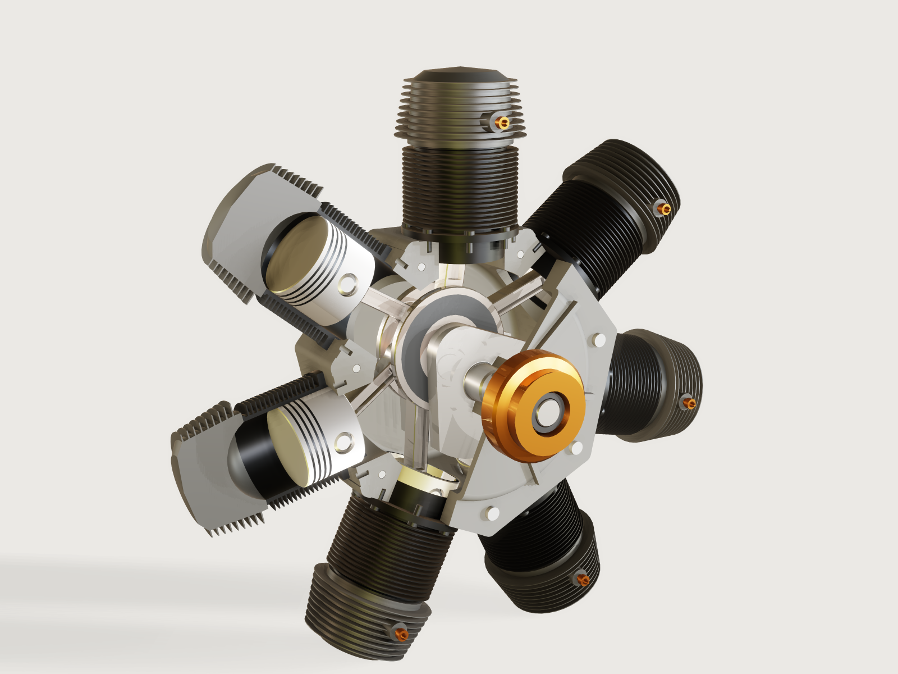

# Seven-cylinder radial engine with its valve train

A seven-cylinder four-stroke air-cooled radial of the 220 hp class, with the bore, stroke and compression ratio of the
Continental R-670 (*References read*) but not a copy of it, and with its valve train, drawn at full size: a
two-piece cast-grey crankcase cut away at the front, a built-up single-throw crankshaft, a one-piece master rod with six
articulated rods on knuckle pins, seven pistons with rings, seven finned cylinders (two of them opened), and the valve
gear: a double-track cam ring that turns at one sixth of the crank speed against it, through reduction gears, in a nose
case cut open to show it, with fourteen roller tappets, pushrods, rockers and poppet valves. One engine cycle of `t`,
two crank turns, drives everything through mates and couplings. The seven piston-and-rod loops are solved as one
mechanism, and the model measures the difference between the cylinders that the master-and-articulated rod system really
has. The tappets and valves follow formulas of the same lift law the cam lobes are drawn from, and the contact between
roller and lobe and between rocker and valve tip is measured over the motion, not assumed.



## What it shows

- **Seven closed loops on one master rod** (`mate.add` `cylindrical` and `revolute`, a variable `Crank_drive_angle` driving the crank).
  Six articulated rods hinge on knuckle pins in the master rod's flange (`Knuckle_2` … `Knuckle_7` fixed,
  `Link_2` … `Link_7` revolute); each piston slides in its bore on a `cylindrical` mate and its roll is stopped by
  the wrist pin revolute, as in the real thing. `assembly.solve` leaves 0 degrees of freedom. The motion is one
  driver: the variable `Crank_drive_angle`, a formula of `t`.
- **A rigid subassembly placed seven times** (`parts/cylinder.json`, an `assembly.new` script): the barrel, the head,
  the two rocker brackets with their pins and the two valve springs are one unit, placed by `instance.add` with its bore, deck height and
  chamber height in `params`, and mated by name through the subassembly (`Cylinder[3]/Barrel/Mount`,
  `Cylinder[3]/Head/Rocker I`).
- **Parts of several bodies, fitted:** the valve with its two split locks and its retainer, the tappet with its roller
  and the axle pressed into its fork, the rocker bracket with its pin, the cam ring with its locating spigot: each is one part
  whose bodies stay apart by their fits (asserted in the part from below and above), so each can be
  put together, and none adds a mate.
- **A fit as a proven minimum and a measured maximum:** each fit of the valve gear is a `clearance` (or `distance`)
  assertion with its `min`, whose lower bound is proven, and a `variable.measure` of the same gap with a `value`
  assertion carrying the `max`, so a loose fit fails instead of reading not proven (A-041). The pressed fits (the
  tappet's axle, the rocker pin) and the cam ring's spigot are measured face to face with `distance`, which is
  proven at those gaps where `clearance` is not.
- **A large fit measured face to face:** the cam ring's 300 mm spigot in the nose case is asserted with `distance`
  between the two cylinder faces, found by query (`surface`, `radius`, `in`), because `clearance` between bodies does
  not prove a gap of 0.08 mm at that size (A-034).
- **A chained `sketch.pattern`:** the barrel's sixteen fins are one fin and its gap repeated as a chained run, closed by
  a `sketch.line` from the run's last point (`e34[last]`; `sketch.path` cannot start or end there, A-022). Drawn out
  segment by segment, the barrel alone was 48 KB larger and the packed file over 1 MB.
- **One source placed twice:** the crankcase is drawn as a half with its parting plane at the cylinder centre line;
  placed twice (the front half turned about the cylinder 1 axis), a `section_cut` parameter cuts the front half open
  and carries the through-bolts.
- **Configurations by `params`:** two opened cylinders (`open_section`) are configurations of the same source
  (a `when` on the section cut); the piston, barrel and head follow `bore`, the rods follow `rod_ratio`, the crank
  follows `stroke`.
- **A measured difference between cylinders.** `jointDistance` of each piston's cylindrical mate is asserted
  against an independently derived closed form at every sample (`assert.add`, `motion.check`); each cylinder's top
  and bottom dead centre and compression ratio come out different from the master cylinder's. This is the real
  thing's behaviour, not a model artefact: see *The motion*.
- **Firing order as a check of the model.** The cylinders' placement is measured (`rotation`) against the table of
  the firing sequence 1-3-5-7-2-4-6 at intervals of 720°/7.

- **A cam is not a mate (A-003):** each tappet and valve is a `slider` driven by a formula of `t`, the lift law; the cam
  lobes are drawn by `sketch.curve` from the same law (a cos² lift over the lobe), offset by the roller radius.
- **A gear reduction by couplings:** `gear` couplings tie the crank to the idler and the idler to the cam ring, 24:36 and
  20:80 teeth drawn as plain pitch cylinders, so the ring turns at 1/6 against the crank.
- **Closure through a pushrod:** the rocker is only a revolute; a tappet slider, two revolute pins and the rocker close
  a loop per valve, and the rocker's angle is solved, while the valve follows a formula of the loop's closed form: the
  solved rocker angle (`jointAngle`) and the gap at the rocker pad (`clearance`) are the checks that the two agree.

## The real thing

**References read** (and what each gave):

| Source | What was read | Used for |
|---|---|---|
| Wikipedia, *Continental R-670* (fetched 2026-11-08) | 5 1/8 in (130.2 mm) bore, 4 5/8 in (117.5 mm) stroke, 668 cu in, 5.4:1 compression, 42.5 in (1079.5 mm) diameter, 450 lb, 225 hp at 2175 rpm, seven cylinders, enclosed valve gear | The class: bore, stroke, compression ratio, overall diameter |
| *Continental's Radial Aircraft Engines*, enginehistory.org | The R-670's forged barrels, "machined all over with integral cooling fins", screwed and shrunk into cast aluminium heads; a one-piece master rod with a steel-shelled white-metal bearing and six link rods on knuckle pins with lock plates, H-section rods; a built-up crank with a bolted clamp; a double-track cam ring | The construction of the cylinders, rods and crank |
| FAA-H-8083-32B *Aviation Maintenance Technician Handbook — Powerplant*, chapter 1 | Master-and-articulated rods, knuckle pins (pressed or full-floating, lock plates), "the knuckle pin holes … are not equidistant from the center of the crankpin" to compensate for the elliptical knuckle paths; cooling fins 0.090–0.060 in; cylinder numbering (clockwise from the rear, No. 1 at the top); firing order 1-3-5-7-2-4-6; figure 1-27: a three-lobe cam for seven cylinders turns at 1/6 of the crank, against it | Fits, fin proportions, cylinder numbering, firing order; the cam ring ratio for stage 2 |
| FAA-H-8083-32B chapter 1, four-stroke section | Exhaust valve opens 50 to 75° before BDC; intake valve closes 50 to 75° past BDC; intake opening 8 to 55° before TDC; chart with exhaust closing about 25° ATC; rockers, pushrods, roller tappets | The valve timing used here (IVO 20°, IVC 60°, EVO 65°, EVC 20°) |
| *Continental's Radial Aircraft Engines*, enginehistory.org, on the A-70 and the W670 | "Intake ports faced away from the propeller while exhaust ports faced toward it"; "Valves were actuated by fully-enclosed valve gear featuring a double cam ring, tubular duralumin push rods and forged steel rocker arms"; "Aluminum-bronze valve seats"; heads "featuring integrally cast rocker boxes"; the W670 gear table: "Intermediate Cam Drive Gear CCW 0.1667:1" | The valve gear's layout and what is left off; the cam ring at 1/6 against the crank |
| FAA-H-8083-32B chapter 1, cylinder heads | "the inner shape of a cylinder head is generally semispherical" | Why the flat-roofed chamber here is a simplification |
| G. D. Angle, *Positioning of Link Rod Wrist Pins in Articulated Connecting Rods*, Aviation Engineering, January 1932 | L/R "3.2 to 4.4"; the link radius kept small to limit bending of the master rod; strokes of link cylinders come out longer and differ with the link radius and its angle to the rod axis, and equal strokes need a different link radius per cylinder | The rod ratio of this model (L/R = 4), and the reason its cylinders differ |

Everything else (crank pin 70 mm, knuckle pin 26 mm, wrist pin 34 mm, flange and web sizes, the fit values, the fin
pitch and the counterweights) is my own judgement of the class, stated here and not proven to any manufacturer's
drawing. The enginehistory.org details are of the A-70, the R-670's predecessor, whose layout the R-670 kept. The
model's overall diameter across the rockers is about 1040 mm (`boxMax` of `Rocker[1I]`, 519.8 mm from the crank axis), against
the 1079.5 mm quoted for the R-670. **This model is a demonstration: it is not a design and carries no load calculations.**

**Valve train.** A double-track cam ring (`cam-ring`, three lobes per track; FAA figure 1-27: three lobes at 1/6 of the
crank, against it) runs in a nose case on the front of the crankcase (its bolts to the crankcase are not drawn). The
ring is held concentric with the crankshaft by a locating spigot on its front face, 300 mm across and engaging 11.9 mm,
running in a groove in the 20 mm nose plate with 0.08 mm radial clearance; the groove's floor locates it forward with
0.1 mm. **Rearward nothing locates it in this model:** moved 2 mm aft, it would land on the front face of the idler's
large gear, which turns at another speed. A real ring runs on a bearing of its own (the W670's gear table names a "Cam
Ring Bearing Gear" turning with the crank); that bearing and a rearward thrust face are not drawn. It is driven from the crank through a compound idler on a stud in the nose
plate: crank gear 24 teeth, idler 36 and 20, an internal gear of 80 teeth on the ring, ratio 1/6 reversed, as the W670's
"Intermediate Cam Drive Gear CCW 0.1667:1". The gears are drawn as plain pitch cylinders, without teeth.

Each cylinder has an intake and an exhaust side, each with a roller tappet in a guide boss of the nose case (30 mm of
guide; the roller on an axle pressed into the tappet's fork), a pushrod with ball ends, a rocker on a pin pressed
through a two-cheek bracket on the head, and a poppet valve with a 45° seat face. The valve's head sits on a seat in a
pocket of the chamber roof, 0.05 mm off it, with a throat of 48.2 mm above it, smaller than the 56 mm head; the head is
drawn as one casting with the seat machined into it, where the A-70 shrank in aluminium-bronze seat rings. The stem
carries two split locks in a groove (two half-cones with a 10° split between them), and the locks a retainer.

**Simplifications, said plainly.** The valves stand side by side across a flat-roofed chamber, so that each rocker
stays in one plane; real radials set them fore and aft, the intake facing away from the propeller and the exhaust
toward it (enginehistory.org), in a chamber that is "generally semispherical" (FAA). The rocker boxes, the pushrod
housings and the ports and pipes are left off to show the gear; the real engine's valve gear is fully enclosed. The
spring is drawn at its installed height (33 mm) seated between the head and the retainer (0.05 mm at each end while
the valve is shut), and it does not compress: while the valve is open the retainer passes into it, a contact listed
in `meta.json`; at full lift the top coil shows above the retainer. A spring that compresses was probed and costs too much bake (see *Platform notes*). The rocker pad
stands 0.05 mm off the valve tip, and that gap is kept constant over the motion: it stands for the valve lash but is
not taken up, so the valve moves as soon as the tappet does. The lobe follows a cos² lift over the lobe's duration
(tappet lift 10 mm, intake 260°, exhaust 265°), the rocker ratio is 46 to 40: my own judgement for this class; the
opening and closing angles are within the ranges FAA-H-8083-32B gives. The spark plug enters the chamber through a
14 mm hole in its boss; its thread is not drawn.

**Fits as drawn** (each measured as a radial gap): knuckle pin in the master flange 0.01 mm (drawn as the pressed fit,
FAA's first case: a nominal gap in place of interference, so it reports no overlap, and the pin is fixed to the rod);
knuckle pin in its rod 0.02 mm; wrist pin in the piston bosses 0.015 mm and in the rods 0.02 mm; big end on the crank
pin 0.05 mm; main journals in their bearings 0.05 mm; piston in the bore 0.16 mm; rings in the bore 0.05 mm; cam
ring spigot 0.08 mm; tappet plunger in its guide 0.08 mm; tappet roller on its axle 0.03 mm and the axle in the fork
0.01 mm (pressed); rocker on its pin 0.02 mm and the pin in the bracket 0.01 mm (pressed); valve stem in its guide
0.03 mm; split locks on the stem 0.02 mm and in its groove 0.05 mm; retainer on the locks 0.05 mm. Bearings
are drawn as plain bores of the stated gap, where the R-670 has roller main bearings (enginehistory.org, of the A-70).

**Materials and processes.** The crankcase is a two-piece casting split on the centre line of the cylinders, cast grey:
a rounded heptagon whose seven flats are the machined seats of the cylinders, the corners cast with a 16 mm radius, the
rear wall drafted into its ring and bearing boss (asserted with `draft`) and rounded into the boss, seven ribs on the
rear wall. **There is no fillet at a pad junction, because there are no pads:** round pads on a round ring with a 3.5 mm
rolling-ball fillet at the junction cost 12 to 27 s of CPU for that one part (`findings/A-033-fillet-cost-pad-junction/`;
the budget for the whole engine is 12 s), so the crankcase became a heptagon whose flats need none. The heptagon's sides
and corners and the ribs are drafted 1.2° and 1.5° from the parting plane (`feature.draft`), and one patterned cut
machines the seven seats flat again so the flanges sit square; the cut covers the flange, the rest of each side stays
drafted. Draft is asserted on a cast corner of the heptagon, a face that runs along the pull (1 to 1.4°). Core prints,
machining allowances and wall sections are not modelled, and it is not a foundry pattern. The cast heads have no draft
or fillets beyond their fin profile. The crank webs are rounded into the journals (2 mm) and the front web into the crank
pin (1.5 mm), by arcs in the turned profiles; the webs' own edges are sharp.
Crank halves, rods, knuckle pins and wrist pins are alloy steel forgings, ground and polished (one-piece master rod, as
on the R-670's predecessor A-70, so the crankshaft is built up). Pistons are forged aluminium with cast-iron rings, four
to a piston, drawn alike; the wrist pin is full-floating with an aluminium plug in each end against the bore. Barrels
are alloy steel forgings machined with integral fins, nitrided in the bore; heads are cast aluminium with a
flat-roofed chamber 23.7 mm above the deck, two valve pockets in its roof that are ports when the valve is shut, screwed and shrunk on (this model shows the barrel and head meeting at
a single seat). Fins taper from 2.3 to 1.5 mm, FAA-H-8083-32B's 0.090–0.060 in. The propeller hub is a copper-plated
forged steel hub on the taper of the crank nose, held by a retaining nut on the threaded end (the thread is not drawn,
nor is the hub's key).

**The counterweights are integral with the crank webs** and are not sized to balance: the two webs' sectors put about
350 kg·mm about the crank axis (computed from the drawn outline at 7.85 g/cm³), against a rough 900 kg·mm that a reviewer estimated for this class (an estimate, not a sourced figure; the reciprocating
and rotating masses are not modelled, and no balance is claimed). Larger sectors would
reach the piston skirts at bottom dead centre.

## Parts and assembly order

| Part | Instances | Process |
|---|---|---|
| Crankcase half | 2 (rear whole, front cut away) | Casting, machined seats, through-bolted on the parting plane |
| Crank, front half (longer nose, journal, web with counterweight, crank pin with spigot) | 1 | Forging, machined |
| Nose case (its bolts to the crankcase not drawn) | 1 | Casting, machined cam ring bore and tappet guide bosses, cut away for display |
| Cam ring (body with internal gear and locating spigot, two lobe tracks) | 1 | Forged, ground |
| Crank gear, idler gear, idler stud | 1 each | Machined, drawn as pitch cylinders; the stud's seat in the nose plate lies in the display cut-away, so the stud stands free in the picture |
| Tappet (plunger and fork, roller, axle) | 14 | Machined; axle pressed in |
| Pushrod (2 lengths) | 14 | Tube and ball ends, copper plated |
| Rocker | 14 | Forged, machined |
| Valve (valve, two split locks, retainer) | 14 | Turned and ground; locks and retainer separate |
| Rocker bracket (cheeks and pressed pin) and valve spring | 14 each, in the cylinder unit | Cast bracket, ground pin; spring drawn at its installed height |
| Crank, rear half (tail, journal, web with counterweight, clamp around the spigot, clamp bolt and nut; the halves are drawn without a key) | 1 | Forging, machined |
| Propeller hub with retaining nut | 1 | Forging, machining, copper plate |
| Master rod with lock plates (drawn without their screws) | 1 | Forging, machining |
| Articulated rod | 6 | Forging, machining |
| Knuckle pin | 6 | Turning, hardening |
| Piston (with rings) | 7 | Forged aluminium, turned; cast-iron rings |
| Wrist pin with plugs | 7 | Turning, hardening |
| Cylinder (barrel with eight studs and nuts, head with seats and guides, two brackets, two springs: rigid subassembly) | 7 | Forged barrel with machined fins; cast head; screwed and shrunk |

Assembly order, part by part, each step reachable from the side the next part leaves open:

1. On the bench, the six articulated rods go between the plates of the master rod's flange with their knuckle pins
   pressed in, and the lock plates close the pins' ends on both sides.
2. The rod group's Ø200 flange and Ø70.1 eye go over the crank pin of the front crank half, where it stands free,
   since the rear web is not on it yet. Then the rear crank half is put on the spigot and clamped by its bolt.
3. The crank's rear journal is put into the rear crankcase half, then the front half is closed on the front journal, and
   the two halves are bolted through the ring by the seven through-bolts, each with a head on one side and a nut on the other.
4. The studs are screwed into the seats, seven times eight; each cylinder's skirt enters its seat and its flange goes over
   the studs. Before a cylinder goes on, its piston is put on its rod with the wrist pin and plugs (the pistons are
   reached through the open seat), and the rings are compressed into the barrel as it comes down.
5. The valves go into their guides from the chamber side before the cylinder is mounted (step 4); on top of the head
   the spring goes over the stem, the retainer is pressed down on it and the two split locks go into the stem's
   groove, and the retainer comes up over them. The brackets go on the head, and each rocker between its cheeks on the
   pin pressed through them.
6. The crank gear goes on the nose. The nose case is built up off the engine, from its open rear, in this order (the
   sizes are the drawn ones):
   1. the idler stud is fixed in its seat in the nose plate;
   2. the tappets, each with its roller on the axle pressed through its fork, go into their guide bosses from inside:
      the fork (24 × 26 mm) cannot pass the 24.16 mm guide, so they cannot go in from outside;
   3. each tappet is held out 10 to 12 mm while the cam ring slides past: the lobe tips need more than 10 mm (the
      tappet lift), and at 12 mm the fork reaches the boss. That is a 2 mm window;
   4. the cam ring goes in from the rear, over the stud (inside its 120.2 mm gear bore), until its spigot enters the
      groove in the nose plate, and the tappets are let down onto it;
   5. the idler goes onto its stud through the ring: its small gear (r 119.9 mm from the crank axis) passes the ring's
      124 mm rear bore and meshes in the 120.2 mm internal gear. Its large gear (r 143.9 mm) could not pass the ring,
      which is why the idler goes on after it;
   6. the nose case goes onto the crankcase front (its bolts are not drawn), the idler's large gear sliding axially into
      mesh with the crank gear.

   The pushrods go in between tappet and rocker last, and the hub goes on the taper of the nose, held by its nut.

## The motion

`t` is one engine cycle, two full turns of the crankshaft: `Crank_drive_angle = start_angle + 720 deg * t`, so every
cylinder runs its four strokes once and the cam ring turns a third of a turn, and the motion closes on itself (one turn would end with other
valves open than it started with). The crank pin carries the
master rod; the master rod's piston (cylinder 1) moves as a plain slider-crank. The six articulated rods swing on
their knuckle pins, whose paths are not circles, and drive pistons 2 to 7. There is no free degree of freedom; the
crank turns clockwise seen from the rear, and the cylinders are numbered the same way, No. 1 at the top.

Because all six knuckle pins sit at one radius, the cylinders do not all behave alike. The table below gives the
piston's distance from the crank axis at top and bottom dead centre, from a separate numerical solution of the
linkage with no 3DCraft in it (a Newton iteration on the loop equations, 72,000 steps per turn). The model agrees: at
721 samples over the two turns (one per degree of crank) `motion.check` of the pistons' `jointDistance` reads strokes
of 117.50, 117.56, 118.61 and 118.26 mm for cylinders 1, 2 and 7, 3 and 6, 4 and 5 (the small differences from the table are the sampling: an
extreme falls between samples).

| Cylinder | TDC distance, mm | BDC distance, mm | Stroke, mm (independent) | Crank angle at TDC | Compression ratio |
|---|---|---|---|---|---|
| 1 (master) | 293.75 | 176.25 | 117.50 | 0.0° | 5.40 |
| 2 and 7 | 291.78 | 174.21 | 117.56 | 53.0° / 307.1° | 5.10 |
| 3 and 6 | 291.02 | 172.41 | 118.61 | 108.6° / 251.4° | 5.03 |
| 4 and 5 | 293.29 | 175.02 | 118.27 | 157.5° / 202.5° | 5.35 |

An articulated cylinder's top dead centre is off the master's by up to 2.7 mm and off its nominal crank angle by up to
6°; its stroke is up to 1.1 mm longer. With one combustion chamber per cylinder that gives compression ratios from
5.03 to 5.40. This is uncorrected on purpose: the difference is the point of this model, and it is what a real radial
designs out, by giving each knuckle pin its own radius from the crank pin (Angle, 1932; FAA-H-8083-32B). The firing
order and the 102.86° firing interval are part of the model, at the *nominal placement of the cylinders only*. The
pistons' own top-dead-centre intervals are uneven (108.6, 94.0, 104.5, 105.9, 104.5, 94.0, 108.6°, from the table
above); this engine compensates nothing, neither in the rod geometry nor with a compensated magneto as FAA-H-8083-32B
describes, and fires at nominal placement.

**The valve train in crank degrees.** The ring turns at 1/6 of the crank, against it, through two `gear` couplings; with three
lobes per track that gives every cylinder one event per two crank turns, in firing order. The valve events, in crank degrees
after the firing top dead centre of each cylinder, are: exhaust opens at 115° (65° before bottom dead centre) and closes at
380° (20° after top dead centre), intake opens at 340° (20° before top dead centre) and closes at 600° (60° after bottom dead
centre), so the valves overlap for 40° around top dead centre on the exhaust stroke. The tappet of a valve follows
`10 mm · cos²(π x / D)` with `x` in crank degrees from the lobe centre and `D` the duration; the same law is what
`sketch.curve` draws on the ring, offset by the roller radius (and a 0.04 mm gap, so that contact can be measured).
The rocker is a real closed loop (tappet, pushrod, rocker, solved), the rocker ratio is 46:40 and the peak valve lift
11.5 mm.

## Parameters

Public parameters (`variable.publish`): **bore** (126–134 mm), **stroke** (116–122 mm), **rod ratio** (3.95–4.20, the
master rod length over the crank radius), and **start angle** (0–355°, where the crank stands at `t` = 0, on the firing turn of cylinder 1). The ranges
are limited by the pistons of neighbouring cylinders: their skirts come close near the bottom of the stroke (the
clearance is asserted over the motion at the defaults and at 8 of the 16 corners of these ranges). A short stroke with a short rod would collide. The piston, barrel and
head follow `bore`; the crank, the rods and the deck height follow `stroke` and `rod ratio`.

## Checks

At rest (`document.check`): every mate solved, 0 degrees of freedom; pin and bearing fits measured from above and below;
every piston's and ring pack's diameter against the bore, and the barrels and heads by volume (barrel 1 against an
independent integration of its drawn profile, at the default sizes; the others against cylinder 1; the opened 2 and 3
against the share the section cut leaves); the firing order against the measured placement of every cylinder; the
master cylinder's compression ratio. **That ratio is not an independent measurement of the chamber:** the head's measured
volume is subtracted from a constant calibrated from this same head, so it detects a head that has changed, and away
from the nominal sizes it falls back to the formula and its bound (2 to 12) cannot fail. The rear crankcase half carries
the casting's `draft` check.

Over the motion (`motion.check` at 145 samples, one every 5° of crank; all of it *at the samples*):

- every piston's solved `jointDistance` against an independent closed form of the linkage, to 0.02 mm, and the independent
  table of top and bottom dead centres at the default sizes (within 0.15 mm at the sample nearest each extreme);
- **the cam ring at one sixth of the crank, against it** (`jointAngle` of `Cam_drive` against `-crank_angle / 6`, 0.02°):
  the gears are couplings, so this is the ratio the solve keeps; a wrong gear value fails it;
- **roller on the cam by measure:** `clearance` of the roller of tappets 1 and 4, intake and exhaust, to its lobe track,
  0.005 to 0.13 mm at every sample (0.04 mm drawn; it reads 0.040 mm at every sample). The lobe is a separate body drawn from the law, the tappet a slider
  driven by it: a ring turned out of phase, or a lobe drawn on another law, overlaps or stands off, and fails;
- **lift against the published timing:** the intake tappets of all seven cylinders and the exhaust tappets of cylinders 1
  and 4 against the lift computed from a table of opening and closing angles in crank degrees (`timing`: intake 340° to
  600°, exhaust 115° to 380° after the firing top dead centre) and the firing order, to 0.02 mm. The table is not the lobe
  variables, so a phase moved in the law and the cam together fails here;
- **the valve gear agrees with itself:** each of the 14 rockers, solved through its pushrod, stands at the angle the valve
  formula assumes (0.01°), and the rocker pads of valves 1I, 1E, 4I and 4E keep 0.01 to 0.12 mm to their valve tips;
- **piston-to-valve clearance** of all 14 valves, at least 25 mm at every sample. The crown of piston 1 comes to 26.7 mm
  from the chamber roof at top dead centre (the articulated pistons stop up to 2.7 mm lower), so this holds only while the valves are within
  1.7 mm of their seats when the piston is up: in the overlap the closest is 25.91 mm, valve 1I just after the master piston's top dead centre on the exhaust stroke (t = 0.505, from a finer sampling around the closest of the 145 check samples, which reads 25.93 mm at t = 0.507). This is a timing check
  more than a safety margin: the flat chamber is deeper than the 11.5 mm valve lift, so in this head even a fully open
  valve at top dead centre would clear the crown by about 15 mm;
- **the cam ring held by its spigot:** `distance` between the spigot's face and the groove's face at least 0.04 mm, and
  the same distance as an output at most 0.12 mm (0.08 mm drawn, it reads 0.08 at every sample), while the ring turns;
  a loose bore fails it;
- **the spring seated:** springs 1I and 4E stand 0.02 to 0.08 mm under their retainers whenever the valve is shut;
- the rocker of valve 1I on its pin, 0.01 to 0.03 mm; the clearances of rods, pistons and crankcase, and the pin and
  bearing fits of the engine.

In the parts: the split locks in the stem's groove and the retainer on the locks, the roller on its axle and the axle
in the fork, the rocker pin in its bracket, each from above and below.

No collision at 121 moments at the defaults and 31 at each of 8 of the 16 corners of the ranges, except the listed contact of the valve
retainers with the springs while the valves are open (the springs are drawn at their installed height and do not
compress).

What the samples do not cover: between samples. Contact at the cam and the rocker pad is measured on four of the
fourteen valves (the rocker angle on all fourteen), the spring seat on two, the rocker pin on one. Springs do not
compress and the gear teeth are not drawn, so the gear contact is the coupling's ratio only.

## Files

`parts/*.json` and `build.json` are the sources; the packed `radial-engine.3dcraftasm` and
`exports/radial-engine.step` are written by `tools/assemblies.py build`. `preview.png` by `tools/assemblies.py render`.

## Rebuild

```sh
tools/assemblies.py build radial-engine
tools/assemblies.py render radial-engine
tools/assemblies.py check radial-engine
```

The tool needs the 3DCraft build this repository is pinned to: see [Rebuild and check](../../README.md#rebuild-and-check)
in the README.

## Difficulty

8/10 (reviewer): "Seven articulated loops plus fourteen pushrod–rocker loops, a two-stage gear coupling, lobes drawn
from a law with formula-driven followers proven by measure, multi-body fitted parts, and expert engine knowledge."

## Platform notes

`clearance` between coaxial cylinders with a small gap comes back not proven at larger sizes (A-034: piston and rings in
the bore, found 0.16 and 0.05 mm, "at least 0 mm"; the cam ring's spigot, found 0.08 mm, at least 0), so the piston and
ring diameters are asserted by `extent` along the crank axis, the barrels by volume, and the cam ring's spigot by
`distance` between its two cylinder faces, which is proven. Pose measures (`rotation`, `position`) refuse an instance inside a rigid subassembly while clearance reaches the same
path by its body name: `findings/A-031-pose-measure-rigid-subassembly/`; the firing-order assertions measure the
subassembly itself as a workaround. The barrel and head set their material on their last feature as well (`findings/A-024-instance-material-before-boolean/`: a material set before a later feature is lost to an instance, here even when that feature is switched off by `when`). There is no way to assert a measure's minimum or maximum over the motion; the stroke of
each articulated cylinder (an extreme that falls between crank angles nothing can name) is therefore bounded by
per-cylinder values from the independent calculation, and read from `motion.check` for the README.

`clearance` reports two bodies as clear when one lies wholly inside the other (A-042): with a valve open, the retainer
encloses the spring's top coil, and the output `spring_gap_4e` reads 0.548 mm at the stored pose. The spring-seat
assertions are therefore gated to the valve shut (`when`), where the retainer sits 0.05 mm above the spring, and no number
in this README comes from them while a valve is open; the overlap itself is listed as a contact.

**A spring that compresses was probed and left out.** One spring part whose installed height is a public parameter,
placed fourteen times at the top level with a fixed mate each and given `floor((33 mm + Valve_kX_distance) / 0.5 mm) *
0.5 mm`, so that moments share configurations: 24 more configurations, and the 120-frame bake took 28 to 31 % longer
side by side with the static spring (17.9 s against 23.4 s and 15.3 s against 19.7 s, at load average 19 to 23). With
the bake already near its budget, the spring stays at its installed height.

The packed file is near its 1 MB budget (988 KB): every packed part with public parameters carries its thumbnail,
about 200 KB in all (`findings/A-040-packed-part-thumbnails/`), so the barrel's fins are drawn as a chained pattern
here. A chain cannot be ended by `sketch.path` (A-022): its last line is a `sketch.line`. The compression ratio cannot
be measured directly: a ray along the cylinder axis (`measure.ray`) is a command, not a measure an assertion or an
output can use, hence the calibrated head envelope.

## Licence

[CC BY 4.0](../../LICENSE-CC-BY-4.0.md); credit line in the [README](../../README.md#licence).
